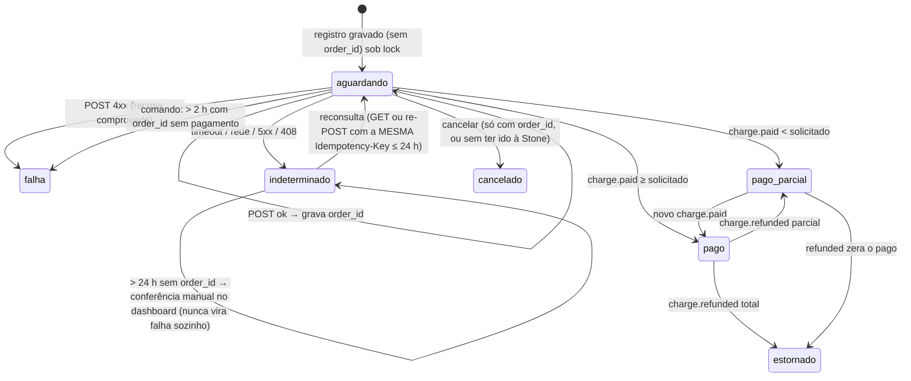

# Prioridade 2 — Connect Stone (POS) no RazelFood

> Parte do plano [migracao-funcionalidades-pizzaria-app-para-razelfood.md](migracao-funcionalidades-pizzaria-app-para-razelfood.md).
> **Data:** 2026-11-04 · **Status:** planejamento, nada implementado.
> **Legenda:** **[FATO]** comprovado no código local do Pizzaria-App · **[INFERÊNCIA]** dedução · **[HIPÓTESE]** confirmar com a Stone · **[DECISÃO]** depende de aprovação.
> **A documentação oficial da Stone/Pagar.me não foi consultada nesta etapa.** O que está descrito é o que o Pizzaria-App faz e o que os comentários do código afirmam sobre a API. Material local de apoio: `Pizzaria-App/docs/Instrucoes-Integracao-Stone.pdf`, `Roteiro-Testes-Homologacao-Stone.md`, `plano/plano-multiplas-maquininhas-connect-stone.md` (decisões D1–D4 de 2026-10-28, já implementadas no código atual).

---

## 1. Arquivos de referência

| Arquivo | Papel |
|---|---|
| `app/Services/Stone/StoneConnectService.php` | Cliente HTTP (criar, fechar, cancelar, consultar pedido) |
| `app/Services/Stone/StoneRecebimentoService.php` (1.124 linhas) | Valor devido, elegibilidade, envio com idempotência, reconsulta, webhook `charge.paid`/`charge.refunded`, bandeira, forma |
| `app/Services/Stone/StoneVendaAutomaticaService.php` | Cria a Venda a partir de Pedido/SessaoMesa e finaliza quando pago |
| `app/Http/Controllers/StoneWebhookController.php` + `app/Http/Middleware/VerifyStoneWebhookAuth.php` | `POST /api/webhook/stone-connect` |
| `app/Console/Commands/StoneConciliarPedidos.php` | Rede de segurança agendada |
| `app/Models/{StonePedido,StoneWebhook,Maquininha,MaquininhaTaxa,SessaoCaixaMaquininha}.php` | Persistência |
| `app/Enums/{StonePedidoStatus,StonePedidoModo,StonePedidoOrigem,OperadoraMaquininha}.php` | Estados e modos |
| `app/Livewire/MesaStoneCobranca.php` | Cobrança da conta da mesa |
| `app/Filament/Pages/OperarVenda.php`, `AtenderPedido.php`, `app/Livewire/PainelEntregador.php`, `PedidosTable` | Pontos de disparo |
| `app/Filament/Resources/{StonePedidos,StoneWebhooks,Maquininhas}` | Telas de acompanhamento |
| `config/services.php` (`stone.*`) | Credenciais e flags (todas via `.env`) |

---

## 2. Configuração e autenticação [FATO]

| Chave | Uso |
|---|---|
| `STONE_CONNECT_BASE_URL` (padrão `https://api.pagar.me/core/v5`) | Base da API |
| `STONE_CONNECT_SECRET_KEY` | Basic Auth: usuário = SecretKey, senha vazia |
| `STONE_CONNECT_SERVICE_REFERER_NAME` | Header `ServiceRefererName` (comentário: "id do parceiro no Stone Partner Hub") |
| `STONE_CONNECT_PEDIDO_DIRETO` (padrão true) | Se a conta está credenciada para o modelo Direto; desligado, tudo cai para Listado sem quebrar |
| `STONE_CONNECT_LIMITE_PEDIDOS_ABERTOS` (padrão 30) | Limite de pedidos abertos por POS |
| `STONE_WEBHOOK_USER` / `STONE_WEBHOOK_PASSWORD` | Basic Auth configurado na URL do webhook no dashboard Pagar.me (Pagar.me v5 não assina corpo com HMAC — comentário do middleware) |

Timeout 15 s; `retry(2, 200ms)` só em fechar/consultar (nunca no POST de criação) [FATO].

---

## 3. Endpoints usados [FATO — observados no código]

| Operação | Chamada | Detalhes |
|---|---|---|
| Criar pedido no POS | `POST /orders` + header `Idempotency-Key: stone-pedido-{id}` | Corpo: `code = rf-{id}`, `customer{name,email}` (e-mail fictício `consumidor@exemplo.com` se não houver), `items[{amount (centavos), description, quantity 1}]`, `closed: false`, `poi_payment_settings{visible, print_order_receipt:false, display_name, devices_serial_number:[serial]}` e, no modo Direto, `payment_setup{type: credit|debit|pix, installments: 1, installment_type: merchant}` |
| Fechar | `PATCH /orders/{id}/closed` `{status: paid|canceled|failed}` | **Obrigatório** após pagar — sem isso o POS para de listar pedidos novos (limite de 30) |
| Cancelar | mesmo PATCH com `canceled` | Só antes de pagar |
| Consultar | `GET /orders/{id}` | Usado na reconsulta e na conciliação |
| Webhooks recebidos | `charge.paid`, `charge.refunded` | Correlação por `data.order.id` / `data.order.code`, **nunca** por `metadata.venda_id` ("a Stone às vezes sobrescreve") |

Campos lidos do charge: `id`, `code`, `paid_amount`/`amount`, `canceled_amount`, `metadata.scheme_name` (bandeira), `metadata.authorization_code`, `last_transaction.transaction_type`/`card.type`, `payment_method` [FATO].

---

## 4. Modos e origens

| Modo | Quando | Comportamento |
|---|---|---|
| **Direto** | Balcão/PDV — a forma escolhida já diz o tipo | POS abre direto a tela do tipo (crédito/débito/PIX, 1 parcela). **Uma cobrança pendente por alvo** (D4) |
| **Listado** | Entrega, envio em lote | Pedido entra na lista do POS; operador escolhe tipo na maquininha; aceita **várias** cobranças/pagamento dividido |

| Origem (`stp_origem`) | Alvo | Quem cria a Venda |
|---|---|---|
| `venda` | Venda do PDV já existente | Operador finaliza no PDV |
| `pedido` | Pedido avulso (balcão/retirada/delivery) | Webhook `charge.paid` → `StoneVendaAutomaticaService` |
| `sessao_mesa` | Conta da mesa | Webhook → venda com itens de todas as rodadas ativas |

---

## 5. Estados de uma cobrança [FATO]



**Regra de ouro:** a cobrança só conta como paga quando o `charge.paid` (ou o `GET /orders/{id}` da conciliação, via `aplicarPedidoDaStone` + payload sintético) é processado. Enviar ao terminal **não** gera `PagamentosVenda` [FATO].

Pendentes = `aguardando`, `pago_parcial`, `indeterminado` — ocupam saldo e vaga do POS.

---

## 6. Regras de negócio

| ID | Regra | Onde | Motivo |
|---|---|---|---|
| RN-STO-01 | **Valor devido** calculado no servidor: Pedido = total − pagamentos combinados já efetuados − cobranças Stone (pago + saldo pendente) − pagamentos manuais na venda gerada; Venda = total − pago − saldo pendente; Mesa = conta aberta (`ContaMesa`) − pago no pedido − saldo pendente | `valorDevido()` | Nunca confiar no estado da tela; impedir cobrar duas vezes |
| RN-STO-02 | Valor informado manual ≤ devido (+ tolerância 0,005); > 0 | `criarRegistroPendente()` | Cobrança parcial permitida, excesso não |
| RN-STO-03 | Elegibilidade (motivo + "oculto/desabilitado"): alvo cobrável; existe maquininha Connect; integração configurada; nenhuma cobrança **indeterminada** no alvo; nenhuma **Direta** pendente no alvo; devido > 0; POS com vaga | `elegibilidade()` | UX e segurança |
| RN-STO-04 | Envio em 2 tempos: transação com `lockForUpdate` (maquininha → alvo, nesta ordem), revalida elegibilidade, grava registro pendente; **commit**; só então HTTP | `enviar()` | Nada de HTTP em transação; 2ª tentativa enxerga a pendente |
| RN-STO-05 | Índice único `stp_chave_pendente` como última barreira contra duas Diretas no mesmo alvo | migration + `UniqueConstraintViolationException` | Corrida entre telas |
| RN-STO-06 | `Idempotency-Key` estável por registro + `code rf-{id}`; reenvio sempre do **mesmo** registro | `criarPedido()`, `reconsultar()` | Timeout não pode criar 2º pedido |
| RN-STO-07 | 4xx = Falha; timeout/5xx/408 = Indeterminado; resposta tardia só tira do Indeterminado (não regride um Pago vindo de webhook adiantado) | `enviarParaStone()` | Ordem dos eventos não é garantida |
| RN-STO-08 | Limite de pedidos abertos por POS (30) verificado sob lock; envio em lote respeita as vagas | `vagasAbertas()`, `iniciarCobrancasEmLote()` | Limite do POS |
| RN-STO-09 | Webhook: grava payload bruto **antes** de processar; Basic Auth inválido → grava e responde 401 sem processar; erro de processamento é engolido e responde 200 | `StoneWebhookController` | Auditoria; evitar retry infinito; conciliação recupera |
| RN-STO-10 | Dedupe por `charge_id` (já processado se outro webhook do mesmo charge gerou pagamento) | `processarChargePaid()` | Webhook repetido |
| RN-STO-11 | `charge.paid` lança `PagamentosVenda` com `tipo_integracao = integrated`, maquininha, bandeira (casada por `scheme_name` com aliases), autorização; no Listado infere a forma pelo tipo da transação (forma integrada do mesmo código fiscal) | `processarChargePaid()`, `resolverOpcaoStone()`, `resolverBandeira()` | NFC-e e fechamento por maquininha |
| RN-STO-12 | Pago completo → fecha pedido na Stone (falha só loga; conciliação refaz) | `fecharPedidoNaStone()` | Limite do POS |
| RN-STO-13 | Origem Pedido/Mesa: webhook cria a Venda (ou **reaproveita** a que o caixa lançou manualmente em paralelo), lança os pagamentos já efetuados no pedido, e finaliza quando pago ≥ total; NFC-e automática se a forma exigir | `StoneVendaAutomaticaService` | Recebimento sem passar pelo caixa |
| RN-STO-14 | Estado do caixa nunca bloqueia o recebimento (sessão única aberta ou venda órfã) | `resolverOuCriarVenda()` | Dinheiro já entrou |
| RN-STO-15 | `charge.refunded`: remove o pagamento, recalcula a venda; se finalizada, lança saída compensatória no caixa; estorno total cancela a venda (`PROBLEMA_PAGAMENTO`) e solicita cancelamento da NFC-e fora da transação; parcial com nota → log de erro | `processarChargeRefunded()` | Espelhar o POS |
| RN-STO-16 | Venda com pagamento `integrated` não é cancelada pelo sistema — estorno é feito **na maquininha** | `CancelamentoVendaService::motivoBloqueioCancelamento` | Fonte da verdade do dinheiro é o POS |
| RN-STO-17 | Cancelar cobrança indeterminada sem `order_id` é proibido | `cancelarCobranca()` | Pode existir no POS |
| RN-STO-18 | Conciliação (agendada): (1) pagos não fechados → fecha; (2) aguardando > 10 min → consulta e reprocessa; (3) pagos sem venda → gera venda; (4) indeterminados/sem order > 2 min → reconsulta/reenvia; (5) aguardando > 2 h com order → falha; (6) vendas finalizadas pelo webhook sem NFC-e → emite | `StoneConciliarPedidos` | Webhook perdido, PATCH falho |

### 6.1 Equipamentos integrados × manuais [FATO]

- `maquininhas.operadora` (Stone, Cielo, Rede, GetNet, Outra), `numero_serie`, **`maquininha_connect_ativo`**. `scopeStoneDisponivel()` = connect ativo + série preenchida.
- `opcoes_pagamentos.opcaopag_stone_integrada` = "esta forma **pode** ser cobrada na Stone" (D1). No PDV o operador escolhe **"Cobrar na Stone"** (só maquininhas Connect) ou **"Lançar manual"** (qualquer maquininha, com bandeira e nº de autorização quando a forma exige).
- Na operação da Empório: Sunmi P2-B integrada; Cielo Flash e Stone Tectoy T8 manuais [FATO, plano de 2026-10-28].
- Pagamento manual em cartão: `pg_venda_maquininha_id` + bandeira + autorização (obrigatória se `opcaopag_requer_autorizacao`), sem `tipo_integracao = integrated` → pode ser cancelado pelo sistema.

### 6.2 Fechamento de caixa

Fechamento confere por forma **e por maquininha** (`fechamentos_caixa_maquininhas`, `sessoes_caixa_maquininhas`), com taxas por maquininha (`MaquininhaTaxa`) [FATO]. No RazelFood isso fica para o módulo de caixa (fora das prioridades); a Fase 2 já grava `terminal_id` em cada pagamento para que o caixa futuro funcione sem migração de dados.

---

## 7. Situação no RazelFood

Nada existe: sem maquininhas, sem pagamentos confirmados, sem webhooks, sem chave de feature para Stone. `payment_options` não tem código fiscal nem flag de integração. A Fase 1.0 (Venda) e o campo `fiscal_payment_code` da Fase 1.1 são pré-requisitos.

---

## 8. Desenho multi-tenant proposto

### 8.1 Credenciais [HIPÓTESE — confirmar com a Stone antes da Fase 2]

| Dado | Escopo provável | Onde guardar |
|---|---|---|
| SecretKey (conta Pagar.me do lojista) | **Por tenant** (cada estabelecimento tem a sua conta/recebimento) | `tenant_payment_integrations.secret_key` (**encrypted**) |
| ServiceRefererName | **Por parceiro** (Razel Tec como integradora homologada) ou por tenant | `config/services.php` (Razel) com override opcional por tenant |
| Usuário/senha do webhook | Por tenant (configurados no dashboard Pagar.me do lojista) | `tenant_payment_integrations.webhook_user/password` (**encrypted**) |
| Modelo Direto habilitado | Por conta | flag por tenant (`direct_mode_enabled`) |
| Limite de pedidos abertos | Por POS | config global, override por tenant |

Perguntas para a Stone: (1) a Razel Tec precisa de homologação própria como parceira para usar o Connect em vários lojistas? (2) `ServiceRefererName` é do parceiro ou do lojista? (3) o lojista cria a SecretKey e nos entrega, ou há OAuth/fluxo de parceiro? (4) webhook é configurado por conta de lojista? (5) o limite de 30 pedidos é por POS mesmo?

### 8.2 Tabelas

| Tabela | Campos principais | Notas |
|---|---|---|
| `payment_terminals` | `tenant_id`, `name`, `provider` (stone/cielo/rede/getnet/other), `serial_number`, `connect_enabled`, `is_active` | unique `(tenant_id, serial_number)` |
| `tenant_payment_integrations` | `tenant_id`, `provider` (`stone_connect`), `secret_key`*, `service_referer_name`*, `webhook_token` (opaco, unique), `webhook_user`*, `webhook_password`*, `direct_mode_enabled`, `max_open_orders`, `enabled_at` (* encrypted) | 1 linha por tenant × provedor |
| `payment_options` (+) | `can_charge_on_terminal` (equivale a `opcaopag_stone_integrada`) | O tipo Stone deriva de `fiscal_payment_code` (credit/debit/pix) como no Pizzaria-App |
| `sale_payments` (Fase 1.0, +) | `terminal_id`, `card_brand_id`, `authorization_code`, `integration_type` (`integrated`/`manual`), `terminal_charge_id` | |
| `payment_terminal_charges` | `tenant_id`, `target_type`/`target_id` (sale/order/table_session — ou 3 FKs como no Pizzaria-App), `sale_id`, `terminal_id`, `payment_option_id`, `user_id`, `provider_order_id`, `provider_order_code`, `provider_charge_id`, `requested_amount`, `paid_amount`, `status` (enum dos 7 estados), `mode` (direct/listed), `error_message`, `closed_at`, `pending_key` (unique, só preenchida em Direta pendente) | Hub de correlação; `code = rf-{id}` usa o id global |
| `payment_webhooks` | `tenant_id`, `provider`, `event`, `hook_id`, `charge_id`, `order_id`, `order_code`, `terminal_charge_id`, `sale_payment_id`, `payload`, `authenticated`, `processed_at` | Auditoria + dedupe |

Recomendação: **3 FKs explícitas** (`order_id`, `table_session_id`, `sale_id`) em vez de morph — facilita locks, índices e o `valorDevido` por tipo, e é o que o Pizzaria-App já validou.

### 8.3 Componentes

| Componente | Observações MT |
|---|---|
| `App\Services\Payments\StoneConnectClient` | Recebe `TenantPaymentIntegration` por parâmetro |
| `App\Actions\Payments\ResolveAmountDue` | RN-STO-01 |
| `App\Actions\Payments\CheckTerminalChargeEligibility` | RN-STO-03 |
| `App\Actions\Payments\StartTerminalCharge` (+ lote) | RN-STO-04..08 |
| `App\Actions\Payments\RecheckTerminalCharge` / `CancelTerminalCharge` | RN-STO-07, 17 |
| `App\Actions\Payments\HandleChargePaid` / `HandleChargeRefunded` | RN-STO-10..16 |
| `App\Actions\Sales\CreateSaleFromTerminalCharge` | RN-STO-13/14 (reusa Fase 1.0) |
| `App\Http\Controllers\Webhooks\StoneWebhookController` | Rota `/webhooks/stone/{webhookToken}` → tenant → Basic Auth do tenant → grava → processa com `CurrentTenant` setado; verifica que o `terminal_charge` resolvido pertence ao tenant da URL |
| `App\Console\Commands\ReconcileTerminalChargesCommand` | RN-STO-18, itera tenants com integração ativa, contexto por tenant |
| UI | Botão "Cobrar na maquininha" no fechamento de conta (Direto), no pedido (Listado), na conta da mesa; `TerminalChargeResource` e `PaymentWebhookResource` no painel do tenant |

### 8.4 Riscos MT específicos

| # | Risco | Mitigação |
|---|---|---|
| R-ST-01 | Webhook do tenant A processado com contexto do B | Token na URL + checagem do tenant do registro correlacionado; teste com dois tenants |
| R-ST-02 | `code rf-{id}` colidir entre ambientes (dev/prod usando a mesma conta Pagar.me) | Prefixo por ambiente/instalação (`rf-{env}-{id}`) [DECISÃO] — o Pizzaria-App é single-instância e não precisou |
| R-ST-03 | SecretKey em log | Nunca logar headers; testes procurando a chave nos logs |
| R-ST-04 | Conciliação de um tenant falhando derruba as demais | try/catch por tenant + log com `tenant_id` |
| R-ST-05 | Conta sem modo Direto | Flag por tenant cai para Listado (comportamento atual) |

---

## 9. Fluxo — balcão (Direto)

```mermaid
sequenceDiagram
  participant Op as Operador
  participant App as StartTerminalCharge
  participant DB as Banco
  participant ST as Stone (Pagar.me v5)
  participant POS as Maquininha
  participant WH as Webhook
  Op->>App: Cobrar R$ X no crédito (Sunmi P2-B)
  App->>DB: TX: lock terminal → lock venda → elegível? → cria charge "aguardando"
  App->>ST: POST /orders (Idempotency-Key, code rf-{id}, serial, payment_setup)
  alt 2xx
    ST-->>App: order_id → grava
  else 4xx
    App->>DB: falha
  else timeout/5xx
    App->>DB: indeterminado (não reenviar; reconsultar)
  end
  POS->>ST: cliente paga
  ST->>WH: charge.paid
  WH->>DB: grava webhook → dedupe → TX: sale_payment + charge pago
  WH->>ST: PATCH /orders/{id}/closed paid
  Note over Op: tela faz polling do status da cobrança
```

## 10. Critérios de aceite (P2)

1. Tenant sem integração ou sem feature: botões ocultos/desabilitados com motivo; nenhum webhook processado.
2. Maquininha manual nunca recebe pedido Connect; operador sempre pode "Lançar manual".
3. Envio não cria pagamento; só `charge.paid`/conciliação criam.
4. Timeout no POST → indeterminado; nova tentativa usa o mesmo registro e a mesma `Idempotency-Key` (teste com `Http::fake` + sequência).
5. Duas abas tentando Direta no mesmo alvo → só uma vence (lock + unique).
6. Webhook duplicado não duplica pagamento; webhook com Basic Auth inválido é gravado e não processado.
7. Pedido de origem `order`/`table_session` vira venda finalizada quando pago; NFC-e automática segue as regras da P1.
8. Estorno total cancela venda e solicita cancelamento da NFC-e; parcial com nota gera alerta visível.
9. Conciliação cobre os 6 cenários de RN-STO-18, tenant a tenant, sem vazamento.
10. Teste de isolamento com dois tenants, duas SecretKeys, dois tokens de webhook.
11. Homologação: reproduzir no ambiente de teste da Stone o roteiro `Pizzaria-App/docs/Roteiro-Testes-Homologacao-Stone.md`.
