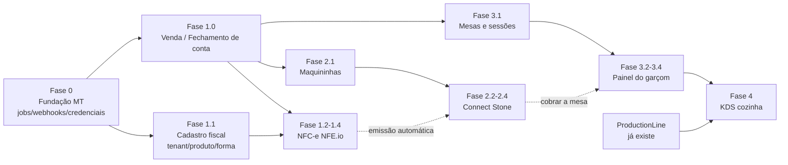

# Migração de funcionalidades — Pizzaria-App → RazelFood

> **Tipo:** auditoria comparativa + levantamento de requisitos + plano de implementação.
> **Data:** 2026-11-04.
> **Status:** aguardando aprovação. **Nada foi implementado.**
> **Legenda:** **[FATO]** comprovado no código local · **[INFERÊNCIA]** dedução a partir do código, sem prova direta · **[HIPÓTESE]** precisa ser confirmado (fornecedor, operação ou decisão) · **[DECISÃO]** depende de aprovação.

Documentos complementares (aprofundam cada módulo):

| Documento | Conteúdo |
|---|---|
| [migracao-nfeio-razelfood.md](migracao-nfeio-razelfood.md) | Prioridade 1 — NFC-e via NFE.io |
| [migracao-connect-stone-razelfood.md](migracao-connect-stone-razelfood.md) | Prioridade 2 — Connect Stone (Pagar.me v5) |
| [painel-garcom-razelfood.md](painel-garcom-razelfood.md) | Prioridade 3 — Painel do Garçom / Salão |
| [painel-cozinha-razelfood.md](painel-cozinha-razelfood.md) | Prioridade 4 — Painel da Cozinha (KDS) |
| [prompts-implementacao-futura.md](prompts-implementacao-futura.md) | Prompts prontos para os agentes de implementação |

---

## 0. Ambiente auditado

| Item | RazelFood | Pizzaria-App |
|---|---|---|
| Caminho local | `/home/gui120599/razelfood` (**minúsculo** — não existe `~/RazelFood`) | `/home/gui120599/Pizzaria-App` |
| Remote | `github.com/gui120599/razelfood.git` | `github.com/gui120599/Pizzaria-App.git` |
| Branch | `main` | `prod-new` |
| Último commit | `eb060672` Brinde: modo de concessão | `66a7f9a5` Notificações no iOS |
| Alterações locais | nenhuma (árvore limpa) | 26 arquivos modificados + 11 não rastreados (CLAUDE.md, `PedidoObserver` cosmético, `RelatorioSessaoCaixaService` + view/teste com nº de autorização, `composer.json` com `laravel/boost`, `vendor/`/`node_modules/` versionados, `docs/plano/notificacoes-push-painel-garcom.md`, `docs/planos/evolucao-modulo-pedidos.md`). **Nada foi alterado, descartado ou sobrescrito.** |
| PHP (CLI local) | 8.4.1 | 8.4.1 |
| Laravel | 12.67.0 (estrutura nova, `bootstrap/app.php`) | 12.65.0 (estrutura **Laravel 10** mantida: `Kernel.php`, `RouteServiceProvider`) |
| Filament | 4.12.6 | 4.12.6 |
| Livewire | 3.8.5 | 3.8.3 |
| spatie/laravel-permission | **8.3.0** (teams = tenant) | **6.25.0** (sem teams) |
| filament-shield | 4.3.1 | 4.3.1 |
| Tailwind | 4.3 | 3.1 (app legado) + 4 (temas Filament) |
| Pacotes só no Pizzaria-App | — | `nfe/nfe`, `nfephp-org/sped-nfe`, `nfephp-org/sped-da`, `barryvdh/laravel-dompdf`, `minishlink/web-push`, `intervention/image`, `laravel/sanctum`, `icetalker/filament-table-repeater` |
| Tamanho | 297 arquivos PHP em `app/`, 33 models | 1.214 arquivos PHP em `app/`, ~150 models |

Fonte usada: **somente o código local**. O GitHub não foi consultado. A documentação oficial da NFE.io e da Stone também não foi consultada nesta etapa — todo comportamento de API descrito aqui é **observado no código** do Pizzaria-App, e os pontos a confirmar com o fornecedor estão marcados como [HIPÓTESE].

> **Observação de nomenclatura.** O Pizzaria-App já usa a marca "RazelFood" nos painéis internos (`brandName('RazelFood Salão')`, commits `4e542ade`/`cf0805e1`) e alguns docs internos dele dizem "O RazelFood…" referindo-se ao próprio Pizzaria-App. Neste plano, **"RazelFood" = o SaaS em `~/razelfood`** e **"Pizzaria-App" = o sistema da Empório da Pizza**.

---

## 1. Resumo executivo

1. **O RazelFood cobre muito bem a ponta "pedido online"**: cardápio, sabores, adicionais, brindes, promoção relâmpago, checkout, taxa por bairro, central de pedidos (kanban), lançamento manual pelo atendente, comanda imprimível, relatórios, planos/features, RBAC por tenant. Nisso ele está no mesmo nível do Pizzaria-App, e em multi-tenancy está à frente.

2. **O RazelFood não tem a camada "venda/caixa"**. No Pizzaria-App, o pedido é só a ordem de produção; quem tem dinheiro e nota é a **Venda** (`vendas` + `pagamentos_vendas`), que agrupa um ou mais pedidos (inclusive todas as rodadas de uma mesa), registra os pagamentos **efetivamente recebidos**, fiado, troco, taxa de serviço e cortesia. No RazelFood, `order_payments` guarda só a **forma declarada no checkout** — não há confirmação de recebimento.

3. **As três primeiras prioridades dependem dessa camada**:
   - a **NFC-e** do Pizzaria-App é emitida **por Venda**, com os pagamentos reais (forma, bandeira, autorização, troco, saldo fiado);
   - a **Connect Stone** cobra um **alvo** (Venda, Pedido ou Sessão de Mesa) e, no `charge.paid`, **cria/atualiza a Venda** e lança o pagamento;
   - o **Garçom** fecha a mesa e a conta fica pendente **no caixa** até virar Venda.

   **Recomendação central [DECISÃO D-01]:** criar, antes da NFE.io, um módulo mínimo de **"Fechamento de conta / Venda" (`sales`)** — sem sessão de caixa obrigatória, sem financeiro — que agregue pedidos e registre pagamentos confirmados. É a base comum de NFC-e, Stone e Salão. A ordem de prioridade do usuário é mantida; só ganha uma **Fase 1.0** dentro da Prioridade 1.

4. **Semântica de "Finalizado" diverge** [FATO]. No Pizzaria-App, `FINALIZADO` = entregue **e pago numa venda finalizada** (`FinalizacaoVendaService`, `PedidoStatusService::marcarEntregue`). No RazelFood, `Finished` é só a última etapa operacional (`OrderStatus::next()`), sem relação com pagamento. Recomendação: **não sobrecarregar** `Finished`; criar situação de pagamento separada (pedido ligado a uma venda finalizada), preservando o fluxo atual de quem não usa PDV.

5. **Multi-tenancy: a arquitetura do RazelFood suporta as integrações, com quatro reforços obrigatórios** (seção 10):
   - credenciais por tenant **criptografadas** (hoje `recaptcha_secret_key` já é texto puro — precedente a não repetir);
   - **webhooks sem sessão** precisam resolver o tenant pelo registro correlacionado e setar `CurrentTenant` explicitamente;
   - **jobs/commands** precisam de contexto de tenant explícito — o `TenantScope` vira no-op quando `CurrentTenant` é nulo, ou seja, um job sem contexto **enxerga todos os tenants**;
   - numeração fiscal por **CNPJ emitente** (não por tenant).

6. **O painel da cozinha (KDS completo)** do Pizzaria-App — setores, rotas de produção, itens de produção por unidade, ficha técnica viva, expedição, tablets pareados — **não é pré-requisito do garçom**. O garçom precisa só do status por rodada (já existe no RazelFood via `OrderStatus`) e do aviso de "pronto". O KDS fica na Prioridade 4, como módulo independente.

7. **Grande volume do Pizzaria-App fica fora deste plano** por não estar nas prioridades: financeiro completo, folha de ponto, checklists, compras/NF-e de entrada (SEFAZ), ficha técnica/CMV, estoque avançado, push notifications, influenciadores (**excluído**). Estão classificados na matriz (seção 3) para roadmap futuro.

8. **Guardrail do `CLAUDE.md` do RazelFood precisa ser revisto antes de implementar** [DECISÃO D-02]: ele declara "fora de escopo por ora: caixa/PDV, fiscal/NFe, pagamento integrado". Este plano propõe exatamente esses módulos; aprovar o plano implica atualizar esse guardrail (e `docs/requisitos-regras-negocio.md` §9/§11).

---

## 2. Arquitetura dos dois sistemas

### 2.1 Pizzaria-App (single-tenant, operação real)

- **Uma empresa** (`Empresa::first()` em todo lugar: NFE.io, numeração, push, maps). Configuração operacional em `config/pizzaria.php` + `.env` (taxa de serviço, SLA, QR da mesa, PIN, polling) e credenciais Stone/NFE.io-webhook no `.env`.
- **Duas interfaces coexistindo**: MVC legado (`routes/web.php`, Blade, `VendaController`, `SessaoMesaController`) + **4 painéis Filament**: `admin`, `garcom` (`/garcom`), `cozinha` (`/cozinha`), `influenciador` (excluído).
- **Núcleo de domínio**: `Pedido` (produção) → `ItensPedido` → `Venda` (financeiro/fiscal) → `PagamentosVenda`; `Mesa` → `SessaoMesa` (conta) → N `Pedido` (rodadas); `SessaoCaixa` → `Venda`; `StonePedido` (hub de cobrança); `NfEmissao` (reserva de número fiscal).
- **Regras centralizadas em Services** com `DB::transaction` + `lockForUpdate` (`PedidoStatusService`, `FinalizacaoVendaService`, `AtendimentoMesaService`, `StoneRecebimentoService`, `NfNumeracaoService`). Observers fazem efeitos colaterais (estoque em `PedidoObserver`, produção em `PedidoProducaoObserver`).
- **Tempo real**: polling (`wire:poll`, 5–30 s) com "contador de versão" em cache (`CozinhaTempoReal`), Reverb opcional; Web Push (VAPID) para o garçom.
- **Agendador**: 20 comandos em `app/Console/Kernel.php` (reconciliação NFE.io, conciliação Stone, liberação/atraso da cozinha, ponto, checklists, push).

### 2.2 RazelFood (SaaS multi-tenant)

- **Banco único + `tenant_id`** em toda tabela de domínio; models estendem `TenantScopedModel` (trait `BelongsToTenant` → `TenantScope` global + preenchimento de `tenant_id` no `creating`). Tabelas filhas (`order_items`, `order_payments`) **não têm** `tenant_id` — isolamento herdado do pai.
- **Tenancy por path** (domínio único): cardápio `/{slug}` (`ResolveTenantFromPath`), painel `/painel/{slug}` (tenancy nativa do Filament + `ApplyTenantScopes` persistente), central `/admin`. `CurrentTenant` é estático; `PermissionRegistrar::setPermissionsTeamId()` isola papéis (spatie teams).
- **Catálogo de features/planos** (`features`, `plans`, `plan_feature`, `tenant_feature_overrides`, `FeatureKey`, trait `GatedByFeature`). Já existem as chaves **reservadas** `pdv`, `estoque`, `nfe_emissao`, `nfe_entrada` (`is_available = false`).
- **Actions** em `app/Actions/**` (padrão do projeto, não "Services"): `CreateOrderFromCart`, `UpdateOrderFromCart`, `AdvanceOrderStatus`, `CancelOrder`, `AllocateOrderNumber` (lock), etc.
- **Painéis**: `central` (`/admin`) e `tenant` (`/painel/{slug}`). Central de Pedidos = página `Kitchen` (kanban por status, `wire:poll.15s`). Lançamento manual = página `AttendOrder`.
- **Infra**: HostGator compartilhado, `QUEUE_CONNECTION=database`, cron `schedule:run` + `queue:work --stop-when-empty --max-time=50` a cada minuto, `CACHE_STORE=database`, `BROADCAST_CONNECTION=log` (sem WebSocket). **Nunca `route:cache`**.

### 2.3 Diferenças estruturais que afetam a migração

| Tema | Pizzaria-App | RazelFood | Impacto |
|---|---|---|---|
| Nomenclatura | Português com prefixo de tabela (`pedido_status`, `item_pedido_valor`) | Inglês sem prefixo (`status`, `unit_price`) | No back-end, só as regras são aproveitadas. O front-end é copiado, com tradução dos vínculos (§2.4.9). |
| Pedido × Venda | Separados | Só `orders` | Criar `sales` (D-01). |
| Pagamento | `pagamentos_pedidos` (combinado/declarado) **e** `pagamentos_vendas` (recebido) | Só `order_payments` (declarado, snapshot de nome) | Pagamento confirmado nasce no módulo Venda. |
| Forma de pagamento | Rica: `opcaopag_desc_nfe`, `envio_automatico_nfe`, `stone_integrada`, `requer_bandeira`, `requer_autorizacao`, taxa, troco | `name`, `is_cash`, `show_in_menu` | Estender `payment_options`. |
| Produto fiscal | NCM, CFOP, CSOSN, CEST, origem, unidade, alíquotas, GTIN | Nenhum campo fiscal | Estender `products` (ou tabela de perfil fiscal). |
| Configuração | `config/pizzaria.php` + `.env` + `Empresa` | Colunas em `tenants` + páginas `OrderSettings`/`EstablishmentSettings` | Tudo que é `.env` no Pizzaria-App vira **config por tenant**. |
| Jobs | `dispatchAfterResponse`, single-tenant | Fila `database`, só jobs de dados globais (bairros) | Criar padrão de job tenant-aware. |
| Permissões | Strings livres (`emitir:nfe`, `cancelar_item:pedido`) | Shield (`View:Kitchen`) + custom permissions listadas em `config/filament-shield.php` | Toda permissão nova precisa entrar em `custom_permissions` (`.ai/rules/config.md`) senão some ao editar papel. |

### 2.4 Convenções obrigatórias do RazelFood

> **Regra-mãe (revisada em 2026-11-06):** o RazelFood e o Pizzaria-App são **o mesmo sistema**: um é SaaS multi-tenant e o outro é a instalação de origem. O Pizzaria-App é fonte das **regras de negócio** e do **front-end, que é copiado para o RazelFood** (§2.4.9). No back-end, ele **não** é fonte de código, nomes internos nem organização de pastas. Toda implementação derivada deste plano segue os padrões abaixo, extraídos do `CLAUDE.md`, das `.ai/rules/**` e do código atual do RazelFood (conferidos em 2026-11-04). Os nomes de classes e tabelas citados nos documentos de `docs/plano/` são **propostas** que já obedecem a esta seção. Se houver conflito entre um documento do plano e esta seção, ou entre esta seção e uma regra mais nova em `.ai/rules/`, **vale a regra do projeto**.

#### 2.4.1 Fontes que o agente deve ler antes de codificar

1. `CLAUDE.md`: guardrails, Boost, Sail, Pint, PHPUnit.
2. `.ai/rules/index.md`: ler **toda** regra cujo glob cubra os arquivos tocados (inclusive `general.md`, que vale para `**`) e rodar `grep -rin '<palavra-chave>' .ai/rules`.
3. `docs/requisitos-regras-negocio.md` e `docs/modelagem-middleware-multitenant.md`.
4. `docs/identidade-visual-design-system.md` para qualquer UI.
5. Arquivos "irmãos" do que será criado (o `CLAUDE.md` exige seguir a estrutura e a nomenclatura dos vizinhos).

#### 2.4.2 Idioma e nomenclatura

| Elemento | Padrão | Exemplo existente | Proposta do plano |
|---|---|---|---|
| Classes, métodos, variáveis, propriedades | **Inglês**, nomes descritivos | `ResolveDeliveryFee`, `usesInTransitStage()` | `ReserveFiscalNumber`, `isPendingOnTerminal()` |
| Tabelas | Inglês, **plural**, snake_case, **sem prefixo de coluna** | `orders`, `order_payments`, `delivery_zones` | `sales`, `sale_payments`, `fiscal_documents`, `payment_terminals`, `dining_tables`, `table_sessions` |
| Pivots | Singular, ordem alfabética | `category_production_line`, `product_gift`, `plan_feature` | `sale_order` (se necessário) |
| Colunas | Inglês snake_case; FK `{model}_id`; timestamps de evento `*_at`; boolean `is_*`/`requires_*`/`uses_*`/verbo | `cancelled_by_user_id`, `accepted_at`, `is_cash`, `requires_address`, `uses_in_transit_stage` | `issuer_cnpj`, `authorized_at`, `connect_enabled`, `auto_issue_fiscal_document` |
| Snapshot histórico | Nome copiado + FK opcional, para preservar histórico | `orders.payment_option_name`, `order_payments.payment_option_name` | `sale_payments.payment_option_name` |
| Enums | `string`-backed, **cases TitleCase**, **valores snake_case minúsculos**, métodos `label()` (pt-BR) e `color()` próprios (não `HasLabel` do Filament), regras de transição no próprio enum | `OrderStatus::InTransit = 'in_transit'`, `next()`, `canBeCancelled()` | `TerminalChargeStatus::PartiallyPaid = 'partially_paid'`, `FiscalDocumentStatus::Authorized` |
| Textos de interface, mensagens de exceção, docblocks e comentários | **Português** | `OrderTransitionException` ("mensagem segura para mostrar a quem opera") | idem |
| Segmentos de URL voltados ao usuário | Português | `/acompanhar`, `/comanda`, `/entrega`, `/painel`, página `Kitchen` com slug `cozinha` | painel `/garcom/{slug}`; `/webhooks/...` (não voltado ao usuário) |
| Nomes de rota | Inglês com ponto | `order.tracking`, `reports.orders.print` | `webhooks.nfeio`, `webhooks.stone` |
| Comandos Artisan | Inglês, `dominio:acao-kebab`; classe com sufixo `Command` | `promotions:reset-recurring` (`ResetRecurringPromotionsCommand`), `tenant:seed-roles` | `fiscal:sync-status` (`SyncFiscalDocumentsCommand`), `payments:reconcile-terminal-charges` |
| Jobs | Sufixo `Job` | `ImportNeighborhoodsFromRuaCepJob` | `IssueFiscalDocumentJob` |
| Permissões custom | snake_case literal, **fora** do padrão `Entity:action` do Shield | `manage_order_status`, `mark_order_delivered`, `edit_order_advanced_status` | `manage_sales`, `emit_fiscal_document`, `cancel_fiscal_document`, `charge_terminal`, `authorize_manager_action` |
| Chaves de feature | snake_case em `App\Support\FeatureKey` (constante) | `CENTRAL_DE_PEDIDOS = 'central_de_pedidos'`, `NFE_EMISSAO = 'nfe_emissao'` | `STONE_CONNECT = 'stone_connect'`, `SALAO = 'salao'`, `KDS = 'kds'` |

#### 2.4.3 Estrutura de pastas e camadas

| Camada | Onde | Padrão |
|---|---|---|
| Regra de negócio / casos de uso | `app/Actions/{Domínio}/` | Classe **invocável** (`public function __invoke(...)`), uma responsabilidade, resolvida via container (`app(Action::class)(...)`); helpers internos em `app/Actions/{Domínio}/Support/` (ex.: `CartStockAndPromotionLedger`, `RecordsOrderPayments`). Domínios novos: `Sales`, `Fiscal`, `Payments`, `Floor` (salão), `Kitchen` |
| Cliente de serviço externo | `app/Services/{Área}/` | Ex.: `Services/Address/ViaCepClient`, `Services/Security/RecaptchaVerifier` → `Services/Fiscal/NfeIoClient`, `Services/Payments/StoneConnectClient`. **Só HTTP e tradução de resposta**, sem regra de negócio, credenciais recebidas por parâmetro |
| Value objects / utilitários / leitura | `app/Support/{Área}/` | Ex.: `Support/Orders/OrderUrgencyResolver`, `Support/Reports/ReportPeriod` → `Support/Fiscal/FiscalReadiness`, `Support/Floor/TableBill` |
| Exceções de domínio | `app/Exceptions/{Domínio}Exception.php` | Ex.: `CheckoutException`, `OrderTransitionException` → `FiscalDocumentException`, `TerminalChargeException`, `TerminalChargeUnknownResultException` |
| Models | `app/Models/` | Domínio estende `App\Models\Concerns\TenantScopedModel`; `$fillable` explícito; casts no método `casts()`; enums e `decimal:2` castados; relação inversa obrigatória para `BelongsToMany` usada em RelationManager (`.ai/rules/models.md`) |
| Resources do tenant | `app/Filament/Tenant/Resources/{Plural}/{Singular}Resource.php` + `Pages/`, `Schemas/{Singular}Form.php`, `Tables/{Plural}Table.php`, `RelationManagers/` | Igual a `Orders/OrderResource`, `Products/ProductResource` |
| Pages do tenant | `app/Filament/Tenant/Pages/` (subpasta por área se houver várias, ex.: `Orders/AttendOrder`) | `HasPageShield` |
| Componentes Livewire do painel | `app/Filament/Tenant/Livewire/{Área}/` | Ex.: `Orders/ProductCatalogSelector`. A view do seletor passa a ser a cópia de `pedido-produto-selector.blade.php` (Fase 1.S) |
| Suporte Filament compartilhado | `app/Filament/Tenant/Support/`, `app/Filament/Support/` | Ex.: `OrderStatusActions`, `InputMasks`, `EstablishmentDocumentFields` (CNPJ/endereço: reusar, não duplicar) |
| Gating por feature | `App\Filament\Tenant\Concerns\GatedByFeature` + `requiredFeature()` | Resources: trait combinada com `parent::canAccess()`. **Pages com `HasPageShield`: usar alias de trait, nunca a `GatedByFeature` genérica** (`.ai/rules/pages.md`) |
| Resources do painel central | `app/Filament/Resources/` | **Nunca** `shield:generate --panel=central`; autorização por `CentralPanelPolicy` + `central_role` |
| Novo painel (garçom, futuro KDS) | `app/Providers/Filament/{Nome}PanelProvider.php`, registrado em `bootstrap/providers.php` | Tenancy nativa do Filament (`->tenant(Tenant::class, slugAttribute: 'slug')`) + `ApplyTenantScopes` como `tenantMiddleware(..., isPersistent: true)`; `User::canAccessPanel()` atualizado (`.ai/rules/models-filament.md`) |
| Controllers HTTP | `app/Http/Controllers/` (subpasta por área: `Reports/`, `Webhooks/`) | Fora do painel, checar acesso com `Auth::user()->canOperateInCurrentTenant()`, nunca `tenant_id === CurrentTenant::id()` (quebra o super admin Platform) |
| Livewire público (fora do painel) | `app/Livewire/` | Restaurar o tenant com `App\Livewire\Concerns\EstablishesTenantContext` (o `POST /livewire/update` não passa por `ResolveTenantFromPath`) |
| Middleware | `app/Http/Middleware/`, registro em `bootstrap/app.php` ou no grupo de rota | Não existe `Kernel.php` (Laravel 12 streamlined) |
| Agendamento | `routes/console.php` (`Schedule::command(...)->withoutOverlapping()`), compatível com cron de 1 min do HostGator | Não existe `Console/Kernel.php` |
| Validação de documento | `app/Rules/` | Reusar `ValidCpf`, `ValidCnpj` |
| Notificações | `app/Notifications/` | Notificação de banco do Filament |

#### 2.4.4 Banco e migrations

- Criar por `sail artisan make:migration` (nome `create_x_table` / `add_y_to_x_table`), uma responsabilidade por migration, `down()` reversível.
- Toda tabela de domínio com `foreignId('tenant_id')->constrained()->cascadeOnDelete()` e índices compostos começando por `tenant_id` (padrão `orders`: `['tenant_id','status']`, `['tenant_id','created_at']`).
- Dinheiro em `decimal(10, 2)` com cast `decimal:2`; rateio em centavos (inteiro) só no cálculo, como já faz o ledger.
- Alterar coluna existente repetindo todos os atributos anteriores (regra Boost).
- Migrations de backfill de dados separadas das de schema (padrão `backfill_order_payments_and_drop_payment_columns_from_orders_table`).
- **Nunca** `migrate:fresh`/`--env=testing` (`.ai/rules/general.md`); confirmar o banco alvo antes de qualquer comando destrutivo.

#### 2.4.5 Segurança e multi-tenancy

- Credenciais com cast `encrypted` e fora da tabela `tenants`, que é cacheada em `tenant:slug:*` (§10.3).
- Config numérica vinda de `env()` com cast explícito `(int)`, `(bool)` ou `(float)` (`.ai/rules/config.md`).
- `route()` **sem** o parâmetro `tenant` (vem de `URL::defaults`), salvo para gerar URL de outro tenant (`.ai/rules/routes.md`).
- Papéis com spatie teams: atribuir com `syncRoles()` + `setPermissionsTeamId()`, **nunca** `Select::relationship('roles')` (`.ai/rules/users.md`).
- Checagens de permissão por `$user->can(...)`, para passar pelo `Gate::before` do super admin Platform (`AppServiceProvider`).
- Permissão custom nova: `config/filament-shield.php` → `custom_permissions`, com `format_custom_permission_keys = false`; incluir em `App\Actions\Tenants\SeedDefaultTenantRoles` (com `Filament::setCurrentPanel()` quando rodar fora de request — `.ai/rules/commands.md`).
- Resource/Page nova: rodar `shield:generate --panel=tenant --all --no-interaction` e depois `tenant:seed-roles {id}` nos tenants do dev (`.ai/rules/resources.md`).
- Nenhuma chamada HTTP externa dentro de `DB::transaction`; transições sob `lockForUpdate`, idempotentes.

#### 2.4.6 Código PHP

- **Alvo PHP 8.4**: o servidor exige `>= 8.4.1` (`composer.json` → `config.platform.php = 8.4.1`) e o CLI local é 8.4.1. A linha "PHP 8.5" do bloco Boost no `CLAUDE.md` é genérica; **não usar recursos exclusivos do 8.5**.
- Chaves em toda estrutura de controle; constructor property promotion; tipos de parâmetro e retorno explícitos; PHPDoc com array shapes (`@param array{...}`), como em `AttendOrder`.
- Sem dependência nova no `composer.json` sem aprovação (ex.: **não** instalar `nfe/nfe` — o Pizzaria-App nem o usa; cliente via facade `Http`, testável com `Http::fake()`).
- Criar arquivos com `sail artisan make:*` (`make:class`, `make:test --phpunit`, `make:filament-resource`…) com `--no-interaction`.
- Rodar `sail bin pint --dirty --format agent` ao final.

#### 2.4.7 Testes

- **PHPUnit** (classes), nunca Pest — converter se aparecer. O exemplo com `Pest\Livewire\livewire` no bloco Boost do `CLAUDE.md` é do pacote; no projeto usa-se `Livewire::test(...)`.
- Organização por área: `tests/Feature/{Área}/` (existentes: `Central`, `Orders`, `Reports`, `Tenants`, `Menu`…) → novas: `Sales`, `Fiscal`, `Payments`, `Floor`, `Kitchen`; `tests/Unit/{Enums,Models,Rules,Support}`.
- `RefreshDatabase` no banco `testing`; no `setUp()`: `CurrentTenant::set()`, `URL::defaults(['tenant' => $slug])` e `setPermissionsTeamId()`, como os testes existentes.
- Fixtures: o projeto **não usa factories de domínio** (só `UserFactory`); cria registros com `Model::create([...])` e helpers em `tests/Concerns` (`CreatesTenantWithFeatures`, `actingAsPlatformAdmin()`). Seguir esse padrão; criar factory só com aprovação.
- Teste de Resource/Page gateado: tenant com `plan_id` que contenha a feature (`.ai/rules/feature.md`).
- HTTP externo sempre com `Http::fake()`; nenhum teste chama NFE.io ou Stone de verdade.
- Rodar o teste afetado após cada mudança e a suíte completa antes de declarar a fase concluída.

#### 2.4.8 Fluxo de trabalho por fase

Modo plano → apresentar arquivos, migrations e decisões (via `AskUserQuestion`) → aprovação → implementação incremental com testes → validação HTTP/navegador real quando houver UI → limpeza dos dados de teste → query de sanidade dos tenants reais (`emporiodapizza`, `lazzopizza`, `admin@razeltec.com.br`) → revisão com o subagente `laravel-reviewer` → relatório em português. Sem commit sem autorização. Registrar armadilhas novas em `.ai/rules/` com `record-rule`.

#### 2.4.9 Cópia do front-end do Pizzaria-App

> **Decisão do usuário (2026-11-06):** o front-end do Pizzaria-App deve ser **copiado** para o RazelFood, porque os dois são o mesmo sistema. Esta regra substitui as propostas anteriores deste plano de criar telas próprias ou apenas replicar a estrutura. Ela vale para **Nova Venda, Atendimento de pedidos, Painel de Pedidos, Garçom, Cozinha e Stone**.

**Regra.** Tela com equivalente no Pizzaria-App nasce da cópia dos arquivos de front da tela de origem. Não se redesenha nem se recria "parecido". O arquivo de origem nunca é alterado.

| O que é copiado | O que é traduzido na cópia | O que não é copiado |
|---|---|---|
| Views Blade (páginas, partials, componentes `x-*`, views de Livewire) com markup, classes Tailwind, Alpine, textos, ordem, abas, modais e atalhos | Vínculos com o back-end: `wire:*`, `$this->…`, propriedades, relações, colunas e `route()`, para os nomes em inglês do RazelFood (§2.4.2) | Classes PHP de negócio: Services, Observers e Models. As regras entram pelas Actions do RazelFood |
| JS de tela (ex.: `pizza-svg-painel.js`, `pizza-svg.js`) e regras do tema (`resources/css/filament/{garcom,cozinha}/theme.css`, `resources/css/marca/`) | `@source` e caminhos do tema | Telas e blocos excluídos ou de funções ainda inexistentes, removidos da cópia (influenciador, carteira, e outros até a fase deles) |
| Configuração visual do painel: `spa()`, `topNavigation()`, `maxContentWidth()`, tema escuro forçado na cozinha, grupos e ordem do menu | Tenancy e rotas para `/{painel}/{slug}` | `Empresa::first()` e configurações globais, que viram dados do tenant |
| Em Resources Filament: mesmos campos, rótulos, colunas, filtros, ações e ordem | Código PHP reescrito com os nomes do RazelFood | — |

**Exceções permitidas (somente estas):**

1. Isolamento, permissões e gating por feature.
2. Marca do tenant (logo e cor) aplicada sobre a tela copiada.
3. Login do garçom: a lista de usuários com PIN (`login-pin`) só entra com dispositivo pareado (MT-10).
4. Blocos de funções que ainda não existem ficam fora até a fase correspondente, voltando sem alteração quando ela chegar.
5. Dependência de front nova segue a aprovação da §2.4.6 (ex.: `boxicons`, importado pelo tema do garçom).

**Como aplicar:**

1. Copiar os arquivos do mapa abaixo **antes** de escrever a página PHP.
2. Criar a página ou o componente Livewire do RazelFood expondo o que a view copiada precisa, com nomes em inglês e chamando as Actions.
3. Comparar com `diff`: a diferença para a origem pode conter só vínculos traduzidos e exceções. O resultado do `diff` entra no relatório da fase.
4. Comparar lado a lado em navegador real, em desktop e celular, com capturas das duas telas.
5. Melhoria visual é aprovada antes e aplicada nos dois sistemas.

**Mapa de cópia (caminhos de origem no Pizzaria-App):**

| Tela | Copiar de | Destino no RazelFood | Situação hoje | Fase |
|---|---|---|---|---|
| Nova Venda | `resources/views/filament/pages/operar-venda.blade.php`, `filament/pages/operar-venda/item-pedido.blade.php`, `livewire/venda-produto-selector.blade.php` | Substitui `Sales/CloseAccount` e `Sales/PendingAccounts` | Diferente | 1.R |
| Atender Pedido | `filament/pages/atender-pedido.blade.php`, `livewire/{pedido-produto-selector,cliente-picker,entrega-pagamento-picker}.blade.php`, `resources/js/pizza-svg*.js` | `Orders/AttendOrder` e componentes de `Filament/Tenant/Livewire/Orders` | Grid parecido; conteúdo a conferir | 1.S |
| Painel de Pedidos | `filament/pages/painel-pedidos.blade.php`, `painel-pedidos/{card,coluna,cancelado-card,detalhes-modal,link-entrega-modal}.blade.php` | `Kitchen` ("Central de Pedidos") | Kanban parecido; conteúdo a conferir | 1.S |
| Vendas e fiscal | `app/Filament/Resources/Vendas`, `RelatorioFiscalNotas` e `NfeWebhooks` (campos e colunas) | `SaleResource`, `FiscalReport`, documentos fiscais | Entregue na Fase 1; a conferir | 1.S |
| Menu | Grupos de `AdminPanelProvider` (Indicadores, Comercial, Salão, Operação, Cozinha, Cardápio…) | `TenantPanelProvider` | Diferente | 1.S (D-09) |
| Maquininhas, Stone | `app/Filament/Resources/{Maquininhas,StonePedidos,StoneWebhooks}`, modais Stone de `operar-venda.blade.php`, `livewire/mesa-stone-cobranca.blade.php` | Resources e modais da Fase 2 | A criar | 2 |
| Mesas e sessões | `app/Filament/Resources/{Mesas,SessoesMesa}` | Resources da Fase 3 | A criar | 3 |
| Garçom | `filament/garcom/pages/{mapa-mesas,atender-mesa,atender-retirada}.blade.php`, `filament/garcom/partials/{sem-conexao,alerta-pronto,pessoas-mesa,carrinho-lateral,mesa-rodadas,mesa-conta}.blade.php`, `components/pedido/*`, `resources/css/filament/garcom/theme.css`, configuração de `GarcomPanelProvider` | Mesmos caminhos em `filament/garcom/` + `WaiterPanelProvider` | A criar | 3 |
| Cozinha | `filament/cozinha/pages/{estacao,expedicao}.blade.php`, `filament/cozinha/pages/estacao/card.blade.php`, `filament/cozinha/partials/operador.blade.php`, `filament/cozinha/producao-pedido-modal.blade.php`, `components/cozinha/*`, `resources/css/filament/cozinha/theme.css`, configuração de `CozinhaPanelProvider` | Mesmos caminhos em `filament/cozinha/` | A criar | 4 |

---

## 3. Matriz comparativa de funcionalidades

Estados: **I** Implementada · **P** Parcialmente · **N** Não implementada · **D** Implementada com comportamento diferente · **NA** Não aplicável · **?** Necessita investigação.
Prioridade: **P1–P4** = prioridades do usuário · **A** alta · **M** média · **B** baixa. Complexidade: **S** pequena · **M** média · **G** grande · **GG** muito grande. MT = adaptação multi-tenant.

### 3.1 Pedidos e cardápio

| Módulo | Funcionalidade | Regra de negócio | Pizzaria-App | RazelFood | Estado | Diferença | Dependências | Prior. | Compl. | MT |
|---|---|---|---|---|---|---|---|---|---|---|
| Cardápio | Cardápio web público | Produtos visíveis, horário, promo | Blade + Livewire (`CardapioController`, `CardapioService`) | `App\Livewire\Menu` | I | — | — | — | — | já MT |
| Cardápio | Sabores (pizza meio a meio) | Preço por **média** ou **maior** sabor (`RegraPrecoSaboresEnum`); pizza **redonda/quadrada** (`FormatoPizzaEnum`) | `QuantidadeSabor`, `ExpansaoSabores` | `FlavorQuantityOption` (rateio por média, RN-16) | P | Falta regra "maior sabor" e formato quadrado | — | M | M | config por categoria |
| Cardápio | Adicionais | Por produto, com estoque | `Adicional`, `AdicionaisProduto` | `Addon`, `ProductAddon` | I | — | — | — | — | — |
| Cardápio | Perguntas/opções do item (ex.: ponto da carne) | Respostas gravadas no item e na NFC-e | `Pergunta`, `PerguntaOpcao`, `item_venda_respostas` | — | N | Não existe | — | B | M | por tenant |
| Promoções | Promoção relâmpago | Teto, limite por pedido, recorrente | `PromocaoRelampago*` | `FlashPromotion*` | I | — | — | — | — | — |
| Promoções | Promoção adicional ("leve junto") | Oferta por gatilho com teto | `PromocaoAdicional*` | Brindes (`ProductGift`, `GiftAwardMode`) | D | Brinde é grátis; promoção adicional tem preço | — | B | M | — |
| Promoções | Cupom de desconto | Rateio em centavos nos itens (`CupomPedidoService`) | `Cupom` (origem interno/influenciador) | — | N | Cupom **interno** é aproveitável; de influenciador é excluído | NFC-e (desconto por item) | M | M | por tenant |
| Pedidos | Status do pedido | INICIADO→ABERTO→PREPARANDO→PRONTO→(EM TRANSPORTE)→ENTREGUE/FINALIZADO | `StatusPedidoEnum`, `PedidoStatusService` | `OrderStatus` + Actions | D | `Finished` ≠ "pago" (ver §1.4) | Venda | P1 | M | — |
| Pedidos | Etapa transporte/entregador opcional | Configurável | `config/pizzaria.php` (`usa_estagio_transporte`, `atribui_entregador`) | `tenants.uses_in_transit_stage`, `assigns_delivery_couriers` | I | RazelFood já é por tenant | — | — | — | já MT |
| Pedidos | SLA por status (atenção/atrasado) | Limites por status | config global por status | `order_attention_after_minutes`/`order_late_after_minutes` (2 limites únicos) | P | Pizzaria tem limite **por status** | — | B | S | por tenant |
| Pedidos | Lançamento pelo atendente | Pedido manual com cliente/entrega/pagamento | `AtenderPedido` (Filament) | `AttendOrder` | I | — | — | — | — | — |
| Pedidos | Edição de pedido | Até "Preparando" livre; depois permissão | `PedidoExclusaoService`, edição no painel | `UpdateOrderFromCart` + `edit_order_advanced_status` | I | — | — | — | — | — |
| Pedidos | Cancelamento com motivo | Motivo obrigatório (enum), estorno de promoção/estoque | `MotivoCancelamentoEnum` | `CancellationReason` | I | — | — | — | — | — |
| Pedidos | Histórico de status | Timeline | `HistoricoStatusPedido` | `OrderStatusHistory` | I | — | — | — | — | — |
| Pedidos | Acompanhamento público | Link de acompanhamento | `AcompanhamentoPedido` (Livewire) | `OrderTrackingController` (token opaco) | I | RazelFood é mais seguro (ULID) | — | — | — | — |
| Pedidos | Confirmação de entrega por QR | Entregador confirma | `EntregaScanController`, `PainelEntregador` | `DeliveryConfirmationController` (URL assinada) | P | Falta painel do entregador e recebimento na entrega | Stone (Listado) | M | M | — |
| Pedidos | Pagamentos combinados no pedido | Forma(s) declaradas; "pago" confirmável (ex.: PIX CNPJ) | `PagamentosCombinadosService`, `opcaopag_confirmavel_no_pedido` | `order_payments` (declarado) | P | Sem confirmação de recebimento | Venda | P1 | M | — |
| Pedidos | Divisão de item | Separar unidades para cobrar parte | `DivisaoItemPedidoService` | — | N | — | Venda, mesa | P3 | M | — |
| Pedidos | Cortesia | Item sai do estoque, não é cobrado, não vai à NFC-e, exige permissão/PIN | `CortesiaService` | — | N | — | Autorização por PIN, Venda, NFC-e | M | M | — |
| Impressão | Comanda | Impressão térmica | DomPDF (`PDFController`), pré-conta de mesa | `orders/ticket.blade.php` (HTML 72 mm) | P | Falta pré-conta de mesa | Mesa | P3 | S | — |
| Clientes | Cadastro + CPF/CNPJ | Documento válido p/ NFC-e | `Cliente` (PF/PJ, IE, e-mail) | `Client` (CPF, sem CNPJ/IE) | P | Falta CNPJ/IE/tipo PF-PJ/e-mail | NFC-e (comprador) | P1 | S | — |
| Clientes | Mesclar duplicados | — | `ClienteMergeService` | — | N | — | — | B | M | — |
| Clientes | Fiado / limite de crédito | Venda com saldo vira título a receber | `FinalizacaoVendaService::validarLimiteCredito`, `DebitosClienteService` | — | N | Depende de financeiro | Venda + financeiro | B | G | por tenant |
| Avaliação | Link de avaliação pós-pedido | — | `AvaliacaoLink` | — | N | Item em aberto #8 do doc de regras | — | B | S | — |
| Mesa QR | Autoatendimento pelo QR da mesa | Cliente pede pelo celular; aprovação do garçom por regra | `MesaCliente/*`, `RegraAprovacaoMesa` | — | N | Fase posterior ao garçom | Mesa/Sessão | B | G | por tenant |

### 3.2 Financeiro, caixa e fiscal

| Módulo | Funcionalidade | Regra de negócio | Pizzaria-App | RazelFood | Estado | Diferença | Dependências | Prior. | Compl. | MT |
|---|---|---|---|---|---|---|---|---|---|---|
| PDV | Venda (agregado financeiro) | Agrupa pedidos/mesas, itens avulsos, pagamentos reais, troco, desconto, taxa de serviço | `Venda`, `OperarVenda` (2.618 linhas), `FinalizacaoVendaService` | — | N | **Base de P1/P2/P3** | — | **P1 (Fase 1.0)** | G | tenant_id em `sales` e `sale_payments` |
| PDV | Alteração de venda finalizada | Reabre, guarda retrato, refaz | `AlteracaoVendaService` | — | N | — | Venda | B | G | — |
| PDV | Cancelamento de venda finalizada | Devolve estoque, reabre pedidos/mesa, exige NFC-e cancelada antes | `CancelamentoVendaService` | — | N | — | Venda, NFC-e | P1 | M | — |
| Caixa | Sessão de caixa (abertura/fechamento) | Troco inicial, suprimento/sangria, fechamento conferido por forma e maquininha | `SessaoCaixa*`, `FechamentoCaixa*`, `MovimentacaoCaixaService` | — | N | Não está nas prioridades; Venda deve nascer com `cash_session_id` nulo | Venda | M (pós-P3) | G | — |
| Caixa | Maquininhas e taxas | Cadastro de terminais por operadora, taxas por bandeira/prazo | `Maquininha`, `MaquininhaTaxa`, `TaxaMaquininhaService` | — | N | Cadastro de maquininha é parte de P2 | — | P2 | M | por tenant |
| Fiscal | **NFC-e (modelo 65) via NFE.io** | Ver doc específico | `NfeIoService` + `Nfe/*` | Feature reservada `nfe_emissao` | N | Ver doc específico | Venda, cadastro fiscal | **P1** | G | credenciais por tenant |
| Fiscal | NF-e de entrada (DistDFe SEFAZ, certificado A1) | Importa notas de compra | `Sefaz/*`, `NfeImportService`, `sped-nfe` | Feature reservada `nfe_entrada` | N | **Não usa NFE.io**; depende de Compras | Compras, estoque | B | GG | certificado por tenant |
| Fiscal | Relatório fiscal de notas | — | `RelatorioFiscalNotasService` | — | N | Entra junto com P1 (versão simples) | NFC-e | P1 | S | — |
| Pagamento | **Connect Stone (POS)** | Ver doc específico | `Stone/*` | — | N | Ver doc específico | Venda, maquininhas | **P2** | G | credenciais por tenant |
| Financeiro | Contas, lançamentos, planos de receita/despesa, centro de custo, contratos, recebíveis | — | `ContaFinanceira`, `Lancamento`, `Financeiro/*` | Fora de escopo (doc de regras §9) | N | — | Venda, caixa | B | GG | — |
| Taxa de serviço | % na conta da mesa | Copiada na abertura da sessão; remover exige permissão/PIN; vai na NFC-e como "outras despesas" rateadas | `sessao_mesa_taxa_servico_percentual`, `TaxaServicoVendaService` | — | N | — | Mesa, Venda, NFC-e | P3 | M | % por tenant |

### 3.3 Salão, cozinha e equipe

| Módulo | Funcionalidade | Regra de negócio | Pizzaria-App | RazelFood | Estado | Diferença | Dependências | Prior. | Compl. | MT |
|---|---|---|---|---|---|---|---|---|---|---|
| Salão | Mesas e comandas | Mesa ou comanda numerada, mesmo ciclo | `Mesa` (`TipoMesaEnum`), `SessaoMesa` | Enum `OrderOrigin::Table`, `OrderFulfillmentType::DineIn` só | N | — | — | **P3** | G | por tenant |
| Salão | Painel do garçom (mapa, atender mesa, rodadas, retirada) | Ver doc específico | Painel `garcom` | — | N | — | Mesa, Venda | **P3** | G | painel tenant-aware |
| Salão | Autorização de gerente por PIN | Ações sensíveis com permissão ou PIN; auditoria | `AutorizacaoGerenteService`, `PinService` | — | N | — | Usuários | P3 | M | PIN por usuário do tenant |
| Salão | Push para o garçom (PWA) | Chamou garçom, pediu conta, pronto | `Push/*`, `minishlink/web-push` | — | N | Pode começar com notificação no painel (polling) | Mesa | M | G | VAPID por instalação, inscrições por tenant |
| Salão | Plantão de freelancers | Quem recebe aviso hoje | `PlantaoFreelancerService` | — | N | Depende de push | Push | B | S | — |
| Cozinha | Central de pedidos (kanban por status) | Colunas por status, ações | `PainelPedidos` | `Kitchen` | I | — | — | — | — | — |
| Cozinha | Linhas/setores de produção | Rota por produto/categoria, etapas | `SetorProducao`, `RotaProducao`, `RoteadorProducao` | `ProductionLine` + `category_production_line` (**só filtro** no kanban) | P | Sem itens de produção nem rota | — | **P4** | GG | — |
| Cozinha | KDS por estação (fila→preparo→pronto por item) | Ver doc específico | Painel `cozinha` | — | N | — | Setores | **P4** | GG | dispositivo pareado por tenant |
| Cozinha | Ficha técnica viva | Ingredientes/passos por sabor | `FichaTecnica*`, `FichaTecnicaMontador` | — | N | — | Estoque/insumos | B | GG | — |
| Estoque | Controle simples (bloquear) | Baixa no pedido | `EstoqueService`, modo bloquear/avisar/não controlar | `controls_stock` + ledger no checkout | P | Falta modo "avisar"; baixa em momentos diferentes (ver RN-PED-05) | — | M | M | — |
| Estoque | Lotes, marcas, balanço, correção, custo médio | — | `EstoqueLote`, `Balanco`, `CorrecaoEstoqueService` | Feature reservada `estoque` | N | — | Compras | B | GG | — |
| Compras | Compras, fornecedores, devoluções, condições | — | `Compra*`, `Fornecedor*` | — | N | — | Estoque, financeiro | B | GG | — |
| Equipe | Folha de ponto, escalas, feriados, repasses, adiantamentos | — | `Ponto/*`, quiosque | — | N | — | Financeiro | B | GG | — |
| Equipe | Checklists operacionais | — | `Checklist/*` | — | N | — | — | B | G | — |
| Horários | Horário de funcionamento | Grade semanal | `HorarioFuncionamento` | `BusinessHour` + `ManageBusinessHours` | I | — | — | — | — | — |
| Relatórios | Vendas, entregas, produção, sessão de caixa, taxa de serviço, cortesias, exceções | — | 15+ páginas | `Reports`, `Deliveries` | P | Os de caixa/fiscal/salão entram junto com seus módulos | Venda | M | M | — |
| Manuais | PDFs de operação | — | `Manuais`, `docs/*.pdf` | — | N | Útil para o SaaS (base de ajuda) | — | B | S | — |
| Influenciadores | Painel, cupons, comissões, carteira | — | Painel `influenciador` | — | **NA (excluído)** | Ver §11 | — | — | — | — |

---

## 4. Levantamento de regras de negócio

Classificação: **[GERAL]** restaurantes em geral · **[PIZZARIA]** específica de pizzaria · **[EMPÓRIO]** particular da Empório da Pizza · **[CONFIG]** deve ser configurável por tenant.

### 4.1 Pedidos

| ID | Regra (comportamento atual) | Motivo operacional | Onde (Pizzaria-App) | Dependentes | Como no RazelFood | Padrão/Config | Riscos |
|---|---|---|---|---|---|---|---|
| RN-PED-01 | Toda transição de status roda em `DB::transaction` com o pedido relido em `lockForUpdate`; gravação sempre via `save()` para disparar observers | Duplo clique / dois operadores baixavam estoque em dobro | `PedidoStatusService` (docblock "duas invariantes") | Estoque, produção, comissão | Já seguido nas Actions do RazelFood; **manter** ao criar novas transições (rodada, venda) | [GERAL] padrão | Observer pulado silenciosamente |
| RN-PED-02 | De PRONTO: delivery → EM TRANSPORTE; mesa/balcão → ENTREGUE | Mesa não "sai para entrega" | `StatusPedidoEnum::proximo()` | Kanban, garçom | Já existe (`next($hasDelivery)`); rodada de mesa deve cair em "sem transporte" | [GERAL] | — |
| RN-PED-03 | `ENTREGUE` vira `FINALIZADO` só quando o pedido já está em venda paga; senão fica ENTREGUE aguardando caixa | Saber o que falta receber | `PedidoStatusService::marcarEntregue` + `FinalizacaoVendaService` | Caixa, relatórios | **Não** mudar `Finished` atual; adicionar vínculo `order.sale_id` + "situação de pagamento" derivada (pendente/pago). Tenant sem PDV continua com o fluxo atual | [CONFIG] (tenant com/sem PDV) | Quebrar relatórios que contam `Finished` como venda |
| RN-PED-04 | Rejeitar = cancelar sem guards de mesa/pagamento, permissão própria | Pedido nunca produzido | `PedidoStatusService::rejeitar` | Kanban | Já existe (rótulo contextual em `CancelOrder`) | [GERAL] | — |
| RN-PED-05 | Estoque baixa ao entrar em **PREPARANDO** e estorna no cancelamento | Pedido não aceito não consome | `PedidoObserver::STATUSES_COM_BAIXA` | Estoque | RazelFood baixa **na criação** (ledger do checkout). Manter, mas ao criar rodada de mesa reutilizar o mesmo ledger | [CONFIG] futuro | Divergência de momento da baixa |
| RN-PED-06 | Desconto de cupom rateado em centavos nos itens; `item_valor` já líquido | NFC-e, caixa e Stone herdam o valor certo | `CupomPedidoService`, `RateioCentavos` | NFC-e | Ao implementar cupom/desconto, ratear por item (necessário para `discountAmount` da NFC-e) | [GERAL] | Nota rejeitada por 1 centavo |
| RN-PED-07 | Cancelar item já lançado numa venda é proibido fora do PDV | Evitar divergência venda × pedido | `AtendimentoMesaService::cancelarItem` | Garçom, PDV | Mesma trava (`order_items.sale_id` não nulo → bloqueia) | [GERAL] | — |

### 4.2 Venda / fechamento de conta

| ID | Regra | Motivo | Onde | Como no RazelFood | Padrão/Config | Riscos |
|---|---|---|---|---|---|---|
| RN-VEN-01 | Venda agrega N pedidos e/ou sessões de mesa + itens avulsos | Uma conta pode juntar várias rodadas/pedidos | `FinalizacaoVendaService::finalizar($idSessaoMesa, $idPedido)` | `sales` + `order_items.sale_id` (item-level, permite conta dividida) | [GERAL] | Cobrar o mesmo item duas vezes — trava por `sale_id` |
| RN-VEN-02 | Finalizar exige pago ≥ total (tolerância de centavos), salvo fiado autorizado | Não fechar conta devendo | `validarPagamento` | Igual; fiado fica fora até existir financeiro | [GERAL] | — |
| RN-VEN-03 | Troco por pagamento; só forma "dinheiro" aceita troco (`opcaopag_troco_padrao`) | Fechamento de caixa | `PagamentosVenda.pg_venda_valor_troco` | `sale_payments.change_amount`, regra em `payment_options.is_cash` (já existe) | [GERAL] | — |
| RN-VEN-04 | Venda criada fora do PDV (webhook Stone) entra na **única** sessão de caixa aberta; com 0 ou 2+ fica órfã para vincular depois | Recebimento nunca é bloqueado pelo estado do caixa | `StoneVendaAutomaticaService::resolverOuCriarVenda` | `sales.cash_session_id` nulo até existir módulo de caixa | [GERAL] | — |
| RN-VEN-05 | Venda cancelada devolve estoque só dos itens avulsos; pedidos voltam a "a receber" | Pedido já produzido consumiu | `CancelamentoVendaService::cancelarFinalizada` | Igual | [GERAL] | — |
| RN-VEN-06 | Cancelar venda com NFC-e autorizada exige cancelar a nota antes (ou em seguida, via estorno Stone) | Obrigação fiscal | `motivoBloqueioCancelamento`, `solicitarCancelamentoNfe` | Igual | [GERAL] | Nota viva de venda cancelada |

### 4.3 Salão (detalhes no doc do garçom)

| ID | Regra | Motivo | Classificação |
|---|---|---|---|
| RN-SAL-01 | Abrir sessão trava a mesa (`lockForUpdate`): dois garçons não abrem duas contas | Concorrência real no salão | [GERAL] |
| RN-SAL-02 | Cada envio à cozinha é um pedido próprio ("rodada"); rascunho INICIADO por garçom; reenviar é no-op | Rede instável no salão | [GERAL] |
| RN-SAL-03 | Fechar mesa pelo garçom **libera a mesa**, mas a conta segue pendente no caixa; sem rodadas a sessão é cancelada; rascunho com itens bloqueia o fechamento | Giro de mesa sem esperar pagamento | [GERAL] |
| RN-SAL-04 | Taxa de serviço copiada na abertura (padrão 10%, ligada por padrão); remover exige permissão ou PIN | Lei/convenção local varia | [CONFIG] |
| RN-SAL-05 | Cancelar item, remover taxa, transferir mesa e conceder cortesia exigem permissão ou PIN de gerente, com auditoria | Fraude/erro no salão | [GERAL] (lista de ações [CONFIG]) |
| RN-SAL-06 | PIN com bloqueio após 5 tentativas por 300 s | Força bruta | [GERAL] |
| RN-SAL-07 | Número de pessoas e taxa com **lock otimista** (versão) | Dois aparelhos editando a mesma conta | [GERAL] |
| RN-SAL-08 | Conta por pessoa com taxa proporcional; "mesa geral" para item sem pessoa | Divisão de conta | [GERAL] |
| RN-SAL-09 | Alerta de mesa parada após 40 min sem rodada | Atenção ao cliente | [CONFIG] |
| RN-SAL-10 | Produto pode ser escondido do cardápio do garçom (`produto_cardapio_garcom`) | Itens só de delivery | [CONFIG] |

### 4.4 Fiscal e pagamentos (detalhes nos docs específicos)

Resumo das regras mais críticas — cada uma é detalhada e referenciada no doc específico:

- **RN-FIS-01..12** (NFE.io): numeração própria por CNPJ/ambiente/modelo/série sob lock; reserva reaproveitada em reenvio; só venda com item fiscal; cortesia fora da nota; frete e taxa de serviço rateados em centavos como "outras despesas"; ajuste de centavos por item (fração de pizza); comprador só com cadastro completo; saldo fiado como `withoutPayment`; emissão automática por forma de pagamento; lock contra emissão dupla; reconciliação agendada; cancelamento confirmado por webhook.
- **RN-STO-01..12** (Stone): nunca considerar pago ao enviar; HTTP fora de transação; registro pendente antes do POST; `Idempotency-Key` estável; `code` próprio `rf-{id}`; 4xx = Falha, timeout/5xx = Indeterminado; reenvio só do mesmo registro; uma cobrança Direta pendente por alvo; valor cobrado = valor devido calculado no servidor; limite de 30 pedidos abertos por POS; fechar pedido na Stone após pagamento; webhook sempre persistido antes de processar e responde 200 mesmo com erro de processamento.

### 4.5 Regras particulares da Empório da Pizza (não levar como padrão)

| Regra | Onde | Tratamento no RazelFood |
|---|---|---|
| Taxa de serviço 10% ligada por padrão | `config/pizzaria.php` | Configuração por tenant (padrão desligado ou 10% — [DECISÃO]) |
| Payload NFC-e fixo em Simples Nacional (CSOSN), `operationNature = "Venda de mercadoria"`, `baseTaxModality = '3'` | `NfeIoService::montarItens` | Configurável por perfil fiscal do tenant; v1 suporta **só Simples Nacional** declaradamente |
| Forma de pagamento detectada por **nome** ("Cartão", "Pix") para mandar bloco `card` | `montarPagamentos` (`stripos`) | Usar o código fiscal (`nfe_payment_code`), nunca o nome |
| PIX CNPJ conferido por extrato | `ehPixCnpj()` | Opcional por forma |
| Uma maquininha Sunmi P2-B integrada, Cielo Flash/Tectoy manuais | Cadastro + `maquininha_connect_ativo` | Genérico: qualquer terminal, flag por terminal |
| Programa de influenciadores, carteira, comissões | Painel `influenciador` | **Excluído** |
| Horários de turno (`janela_operacional` 07:00) | config | Por tenant |

---

## 5. Funcionalidades existentes e ausentes — síntese

**Já existem no RazelFood e não precisam de migração:** cardápio, carrinho/checkout, sabores (média), adicionais, promoção relâmpago, brindes, taxa por bairro/setor, horários, central de pedidos (kanban), lançamento manual, edição de pedido com permissão avançada, cancelamento com motivo, timeline, acompanhamento público, confirmação de entrega por QR, comanda 72 mm, relatórios de pedidos/entregas, clientes com CPF, RBAC por tenant, planos/features.

**Ausentes e priorizadas neste plano:** venda/fechamento de conta (Fase 1.0), NFC-e NFE.io (P1), maquininhas + Connect Stone (P2), mesas/sessões/painel do garçom + autorização por PIN + taxa de serviço + pré-conta (P3), KDS por estação (P4).

**Ausentes e deixadas para o roadmap (fora deste plano):** caixa (sessão/fechamento), fiado, financeiro, cupom, perguntas do item, regra de preço "maior sabor", pizza quadrada, mesa QR, push PWA, ficha técnica, estoque avançado, compras, NF-e de entrada, ponto, checklists, avaliação, manuais.

---

## 6. Integração NFE.io — resumo

Ver [migracao-nfeio-razelfood.md](migracao-nfeio-razelfood.md). Pontos-chave:

- Pizzaria-App emite **somente NFC-e (modelo 65)** pela API `https://api.nfse.io/v2/companies/{companyId}/consumerinvoices` (POST emitir, GET consultar, DELETE cancelar, GET `/pdf` → `{uri}`), autenticação por header `Authorization: {apiKey}` **sem** "Bearer" [FATO].
- Emissão é assíncrona: status final chega por **webhook** (HMAC-SHA1 em `X-Hub-Signature`) ou pelo comando `nfe:sincronizar-status` (a cada 10 min) [FATO].
- **Não guarda o XML localmente** e **não inutiliza** números (só lista candidatos) [FATO] → lacunas a tratar no SaaS.
- Credenciais hoje: `companyId`/`apiKey` em `empresas` **em texto puro**; segredo do webhook no `.env` [FATO].
- No RazelFood: perfil fiscal por tenant (criptografado), campos fiscais em produto e forma de pagamento, `fiscal_documents` + `fiscal_number_sequences` com `tenant_id`, webhook que resolve o tenant pelo documento, job tenant-aware.

## 7. Integração Connect Stone — resumo

Ver [migracao-connect-stone-razelfood.md](migracao-connect-stone-razelfood.md). Pontos-chave:

- Connect Stone roda sobre **Pagar.me Core v5** (`https://api.pagar.me/core/v5`): `POST /orders` (com `closed:false` e `poi_payment_settings.devices_serial_number`), `PATCH /orders/{id}/closed`, `GET /orders/{id}`. Basic Auth com a SecretKey + header `ServiceRefererName` [FATO].
- Máquina de estados `aguardando → pago_parcial → pago → estornado`, `cancelado`, `falha`, `indeterminado` [FATO]. **Pago só por webhook `charge.paid` ou consulta** — nunca pelo envio.
- Terminais integrados e manuais convivem: flag por **maquininha** (`maquininha_connect_ativo` + número de série) e por **forma** ("pode ser cobrada na Stone"); o operador escolhe "Cobrar na Stone" ou "Lançar manual" [FATO, plano D1 de 2026-10-28].
- No RazelFood: credenciais por tenant, webhook com URL por tenant, cadastro de maquininhas, `payment_terminal_charges` com `tenant_id`, conciliação agendada tenant a tenant.

## 8. Painel do garçom — resumo

Ver [painel-garcom-razelfood.md](painel-garcom-razelfood.md). Novo painel Filament `garcom` com tenancy por path (`/garcom/{slug}`), com a mesma estrutura das telas do Pizzaria-App (§2.4.9), com as views copiadas dele (§2.4.9) ligadas às Actions de pedido do RazelFood. Cada rodada = um `Order` (`origin = table`, `fulfillment = dine_in`) ligado a `table_sessions`. Pagamento **não** acontece no painel do garçom na v1: ele fecha a mesa e a conta vai para o fechamento (Venda), com cobrança Stone opcional pela mesa.

## 9. Painel da cozinha — resumo

Ver [painel-cozinha-razelfood.md](painel-cozinha-razelfood.md). O `Kitchen` atual do RazelFood equivale ao "Painel de Pedidos" do Pizzaria-App, não ao KDS. Para o garçom basta: (a) rodada aparecer no kanban com origem "Mesa X", (b) status "Pronto" gerar aviso ao garçom. O KDS (itens de produção por setor, expedição, tablets) é P4 e reaproveita `ProductionLine`.

---

## 10. Requisitos multi-tenant

### 10.1 O que a arquitetura atual já garante

- Isolamento por `TenantScope` em toda query de model `TenantScopedModel` **quando há `CurrentTenant`** [FATO].
- Papéis/permissões por tenant (spatie teams) [FATO].
- Painel do Filament só abre tenants do usuário (`canAccessTenant`) [FATO].
- Cache de tenant por slug invalidado no save de configurações [FATO].

### 10.2 Lacunas que as novas funcionalidades expõem

| # | Risco | Evidência | Mitigação obrigatória |
|---|---|---|---|
| MT-01 | **Job/command sem tenant enxerga todos os tenants** | `TenantScope::apply` só filtra `if ($tenantId = CurrentTenant::id())` | Job middleware/trait `RunsInTenantContext` (recebe `tenant_id`, faz `CurrentTenant::set`, `setPermissionsTeamId`, e `forget()` no `finally`); commands agendados iteram `Tenant::where(status, active)` com a feature ligada |
| MT-02 | Webhook externo chega sem sessão e sem slug | Rotas `/api/webhook/*` do Pizzaria-App são globais | URL **por tenant** com token opaco (`/webhooks/stone/{token}`) ou resolução pelo registro correlacionado com `withoutGlobalScopes()` + validação do tenant antes de setar contexto |
| MT-03 | Credencial de um tenant usada por outro | Pizzaria-App usa `Empresa::first()` | Credenciais **sempre** lidas do tenant do registro (venda/documento/cobrança), nunca do contexto ambiente; cliente HTTP recebe credenciais por parâmetro |
| MT-04 | Credenciais em texto puro | `tenants.recaptcha_secret_key` (RazelFood) e `empresa_api_nfeio_apikey` (Pizzaria-App) | Cast `encrypted` + campo `password()->revealable(false)` no Filament + nunca em logs/payloads de auditoria |
| MT-05 | Numeração fiscal duplicada ou com lacuna entre tenants | SEFAZ numera por **CNPJ + modelo + série** | `fiscal_number_sequences` única por `(issuer_cnpj, environment, model, series)`; dois tenants com o mesmo CNPJ compartilham a sequência (raro, mas possível — mesma empresa, duas marcas) |
| MT-06 | Lock de cache colidindo | `Cache::lock("nfe-automatica:venda:{id}")` | IDs são globais (auto-increment), então não colide; ainda assim prefixar com `tenant:{id}:` por clareza |
| MT-07 | Logs misturados | `Log::channel('stone')` sem tenant | Contexto de log com `tenant_id` (`Log::withContext`) + tabelas de webhook/documento com `tenant_id` |
| MT-08 | Tabelas filhas sem `tenant_id` | `order_items`, `order_payments` | Novas tabelas de dinheiro/fiscal (**`sales`, `sale_payments`, `fiscal_documents`, `payment_terminal_charges`, webhooks**) **com** `tenant_id` próprio — consultas de conciliação e relatórios por tenant sem join obrigatório |
| MT-09 | Slugs reservados | `config/tenancy.reserved_slugs` | Adicionar `garcom`, `cozinha`, `webhooks`, `mesa` (se usados como prefixo de painel/rota) **antes** de criar as rotas |
| MT-10 | Login do garçom por PIN com lista de usuários | `LoginGarcom` lista usuários para toque rápido | No SaaS, a lista só aparece em dispositivo **pareado** ao tenant (token de dispositivo), nunca numa URL pública `/garcom/{slug}/login` |
| MT-11 | Custos/limites do fornecedor por tenant | NFE.io cobra por nota; Stone limita 30 pedidos/POS | Feature por plano (`nfe_emissao`, `pdv`, `stone_connect`), contador de uso por tenant para relatório na central |
| MT-12 | Permissões custom apagadas ao editar papel | Bug já vivido (`.ai/rules/config.md`) | Toda permissão nova (`emit_fiscal_document`, `cancel_fiscal_document`, `charge_terminal`, `authorize_manager_action`…) em `config/filament-shield.php` `custom_permissions` + `SeedDefaultTenantRoles` |

### 10.3 Alterações estruturais propostas (justificadas)

| Alteração | Justificativa | Alternativa descartada |
|---|---|---|
| Tabelas `sales`/`sale_payments` | Pagamento confirmado e nota fiscal são por conta, não por pedido (mesa = N pedidos) | Emitir NFC-e por `Order` com `order_payments`: falha em mesa, conta dividida e Stone parcial, e `order_payments` não é pagamento recebido |
| `tenant_fiscal_settings` (1:1 com tenant) em vez de mais colunas em `tenants` | `tenants` já tem 30+ colunas e é cacheado inteiro em `tenant:slug:*` — credenciais não devem ir para o cache da resolução pública | Colunas em `tenants` |
| `tenant_payment_integrations` (Stone) | Idem; e permite futuros provedores sem tocar em `tenants` | Colunas em `tenants` |
| Trait/middleware `RunsInTenantContext` | MT-01 | Confiar no chamador |

---

## 11. Painel de influencers — exclusão e dependências

Excluído do planejamento. Dependências técnicas encontradas em código que **será** usado como referência (não migrar a parte de influenciador):

- `OpcoesPagamento::opcaopag_carteira_influenciador` e scope que a exclui — ignorar.
- `CancelamentoVendaService::cancelarFinalizada` chama `ConsumoCarteiraService::estornarDaVenda` — omitir no RazelFood.
- `PedidoObserver`/`PedidoStatusService` chamam `ComissaoService::cancelar` — omitir.
- `Cupom` com `OrigemCupomEnum::INFLUENCIADOR` — se cupom for implementado no futuro, só a origem interna.
- `Empresa.empresa_influ_*` — ignorar.

Nenhuma dessas dependências bloqueia NFE.io, Stone, Garçom ou Cozinha.

---

## 12. Dependências

## 13. Riscos

| # | Risco | Prob. | Impacto | Mitigação |
|---|---|---|---|---|
| R-01 | Escopo do PDV crescer até virar o `OperarVenda` de 2.618 linhas | Alta | Alto | Fase 1.0 com escopo fechado (seção 14); fiado, alteração de venda, caixa e cortesia ficam fora |
| R-02 | Nota emitida com dados fiscais errados (CFOP/NCM/CSOSN) por tenant mal cadastrado | Média | Alto (fiscal) | Validação de pré-requisitos antes de emitir (`FiscalReadiness`), ambiente de homologação obrigatório no onboarding, bloqueio de produção até 1ª nota de teste autorizada |
| R-03 | Cobrança duplicada no POS | Baixa (com as regras) | Alto | Portar RN-STO integralmente, com testes de timeout/5xx/webhook duplicado |
| R-04 | Webhook perdido (hospedagem compartilhada, cron de 1 min) | Média | Médio | Reconciliação agendada (NFE.io e Stone) desde a 1ª versão |
| R-05 | HostGator: sem worker contínuo, sem WebSocket | Certa | Médio | Jobs curtos via cron; tempo real por polling com versão; nada de `dispatchAfterResponse` dependente de FPM longo |
| R-06 | Vazamento entre tenants em job/webhook | Média | Crítico | MT-01/MT-02 + testes de isolamento (dois tenants, credenciais diferentes, webhook cruzado) |
| R-07 | Diferença de regime tributário (Lucro Presumido/Real usam CST, PIS/COFINS) | Alta em vendas futuras | Alto | v1 declara suporte **só Simples Nacional**; bloqueio na configuração para outros regimes |
| R-08 | XML não guardado (obrigação de guarda de 5 anos é do emitente) | Média | Alto | [HIPÓTESE] confirmar se a NFE.io oferece download do XML; se sim, baixar e guardar no `storage` privado por tenant |
| R-09 | Relatórios que tratam `Finished` como "vendido" | Média | Médio | Não alterar `Finished`; novos relatórios financeiros usam `sales` |
| R-10 | Credenciais/contrato Stone por parceiro × por lojista indefinidos | Alta | Alto | [HIPÓTESE] confirmar com a Stone antes da Fase 2 (ver doc Stone §8) |
| R-11 | Telas dos dois sistemas divergirem novamente | Alta | Alto | §2.4.9: cópia dos arquivos, `diff` contra a origem e comparação lado a lado em toda fase com UI |
| R-12 | Cópia trazer dependência do back-end do Pizzaria-App (`Empresa::first()`, models em português, influenciador) | Média | Médio | Traduzir todos os vínculos e buscar referências de origem antes de concluir a fase |

## 14. Prioridades e plano de implementação

A ordem do usuário (NFE.io → Stone → Garçom → Cozinha) é mantida. Ajuste proposto: **Fase 0** e **Fase 1.0** antes da NFE.io, porque são dependências técnicas comprovadas.

| Fase | Entrega | Escopo | Fora do escopo | Compl. |
|---|---|---|---|---|
| **0** | Fundação multi-tenant para integrações | `RunsInTenantContext` (jobs/commands), padrão de webhook por tenant, cast `encrypted` + migrar `recaptcha_secret_key`, slugs reservados, features `nfe_emissao`/`pdv` disponíveis, chave nova `stone_connect`, atualização do guardrail do `CLAUDE.md` | Qualquer integração real | M |
| **1.0** | Venda / Fechamento de conta | `sales`, `sale_payments`, `order_items.sale_id`; tela "Fechar conta" a partir de 1+ pedidos; pagamentos reais (forma, valor, troco, bandeira/autorização opcionais); finalizar/cancelar venda; situação de pagamento no pedido; permissão `manage_sales` | Sessão de caixa, fiado, alteração de venda finalizada, cortesia, itens avulsos fora de pedido (avaliar) | G |
| **1.1** | Cadastro fiscal | `tenant_fiscal_settings` (CNPJ, IE, regime, ambiente, companyId, apiKey criptografada, webhook secret, série, % imposto aproximado, envio automático); campos fiscais em `products`; `nfe_payment_code`/`auto_issue_fiscal_document`/`requires_card_brand` em `payment_options`; CNPJ/IE/e-mail/tipo em `clients`; checklist de prontidão fiscal | Certificado A1 (só NF-e de entrada) | M |
| **1.2** | Emissão NFC-e | `NfeIoClient` (credenciais por parâmetro), `fiscal_number_sequences`, `fiscal_documents`, montagem de payload com todas as RN-FIS, emissão manual e automática pós-finalização, consulta, DANFE (URI) | Inutilização, contingência offline | G |
| **1.3** | Ciclo de vida fiscal | Webhook NFE.io por tenant (HMAC), `fiscal_webhooks` (auditoria), comando `fiscal:sync-status` tenant-aware, cancelamento, reenvio, bloqueio de cancelamento de venda com nota viva | — | M |
| **1.4** | Painel fiscal | Lista de documentos por tenant com filtros por situação, relatório fiscal simples, contador de notas por tenant na central | — | S |
| **1.R** | Cópia da tela de venda | Substituir `CloseAccount`/`PendingAccounts` por **Nova Venda**, copiando as views de `OperarVenda` (§2.4.9): abas à esquerda (Pedidos, Produtos; Mesas na Fase 3), itens, cliente, totais e pagamentos à direita, pagamento e cliente em modal, Finalizar/Cancelar, atalhos Alt+C/P/E/O. Reusar `FinalizeSale`, `CancelSale` e o ciclo fiscal | Mudar regras de venda; abas e blocos de funcionalidades que ainda não existem (Mesas, Pendentes/fiado, cortesia, divisão de item) | G |
| **1.S** | Cópia das telas de pedido | Copiar Atender Pedido (com o seletor de produtos, usado também pelo garçom) e Painel de Pedidos; conferir Vendas e telas fiscais da Fase 1; alinhar o menu (D-09) | Mudar regras de pedido | G |
| **2.1** | Maquininhas | `payment_terminals` (operadora, nº de série, `connect_enabled`, ativo) | Taxas/prazos de recebimento | S |
| **2.2** | Stone — cobrança | `tenant_payment_integrations`, `StoneConnectClient`, `payment_terminal_charges`, elegibilidade/valor devido, Direto e Listado, idempotência | Recebimento na entrega (entregador) | G |
| **2.3** | Stone — webhook e conciliação | Webhook por tenant (Basic Auth), `charge.paid`/`charge.refunded`, criação de venda a partir do pedido, NFC-e automática, `stone:reconcile` tenant-aware | — | G |
| **2.4** | Stone — UI | Botão "Cobrar na maquininha" no fechamento de conta e no pedido; tela de cobranças e webhooks | — | M |
| **3.1** | Mesas e sessões | `tables`, `table_sessions`, `orders.table_session_id`, `orders.waiter_user_id`; taxa de serviço por tenant; transferir/reabrir | Mesa QR | M |
| **3.2** | Painel garçom — núcleo | Painel `garcom` (`/garcom/{slug}`), mapa de mesas, atender mesa, rodada (rascunho → enviar), marcar entregue, solicitar/fechar conta, retirada | Push, ponto, checklists | G |
| **3.3** | Autorizações | `manager_authorizations`, PIN por usuário com rate limit, ações: cancelar item, remover taxa, transferir mesa | Cortesia | M |
| **3.4** | Conta da mesa | Pré-conta imprimível, conta por pessoa, fechamento pela Venda, cobrança Stone da mesa | — | M |
| **4.x** | KDS | Ver doc da cozinha (4.1 aviso de pronto ao garçom já entra na 3.2) | Ficha técnica | GG |

Fora deste plano (roadmap): caixa (sessão/fechamento), fiado, cupom, push PWA, mesa QR, estoque avançado, ficha técnica, compras, NF-e de entrada, financeiro, ponto, checklists.

## 15. Estimativas de complexidade

Estimativa em "dias de agente + revisão" (ordem de grandeza, não compromisso):

| Fase | Estimativa | Observação |
|---|---|---|
| 0 | 2–3 | Muito teste de isolamento |
| 1.0 | 5–8 | Maior risco de escopo |
| 1.1 | 2–3 | |
| 1.2 | 4–6 | Payload e rateios de centavos com testes por caso real |
| 1.3 + 1.4 | 3–4 | |
| 2.1–2.4 | 8–12 | Homologação Stone depende de terceiro |
| 3.1–3.4 | 10–14 | UX mobile + concorrência |
| 4 | 12–20 | Modular; pode ser fatiado |

## 16. Critérios de aceite (globais)

0. Código novo segue integralmente a §2.4 (nomenclatura, estrutura, testes, PHP 8.4); divergência só com aprovação registrada. Tela com equivalente no Pizzaria-App nasce da cópia dos arquivos de front e é aprovada por `diff` contra a origem + comparação lado a lado (§2.4.9).
1. Nenhuma query de domínio nova sem `tenant_id` (model `TenantScopedModel` ou filtro explícito justificado).
2. Teste de isolamento em toda fase: dois tenants, dados e credenciais diferentes; webhook/job de um não lê nem grava no outro.
3. Credenciais nunca em texto puro no banco, em log, em payload de auditoria ou no cache de resolução de tenant.
4. Nenhuma chamada HTTP externa dentro de `DB::transaction`.
5. Toda transição de estado de pedido/venda/documento/cobrança sob `lockForUpdate` e idempotente a reenvio.
6. Feature desligada ⇒ telas, botões, rotas e jobs da funcionalidade inertes para o tenant.
7. Permissões novas em `custom_permissions` do Shield e em `SeedDefaultTenantRoles`, com teste de que sobrevivem à edição do papel.
8. Suíte completa verde (`sail artisan test`) contra banco `testing` dedicado — **nunca** `migrate:fresh` sem `.env.testing` (incidente de 2026-08-27).
9. Dados reais de teste do usuário (`emporiodapizza`, `lazzopizza`, `admin@razeltec.com.br`) intactos ao fim de cada fase.
10. Regras registradas em `.ai/rules/` quando houver armadilha nova.

---

## 17. Decisões pendentes

| ID | Decisão | Recomendação |
|---|---|---|
| D-01 | Criar módulo mínimo de Venda antes da NFE.io? | **Sim** (Fase 1.0) |
| D-02 | Atualizar guardrail do `CLAUDE.md` e doc de regras (PDV/NFe/pagamento integrado entram no escopo como features de plano)? | Sim, junto com a Fase 0 |
| D-03 | Conta NFE.io: uma conta da Razel Tec com várias empresas, ou cada tenant com a própria conta? | Ver doc NFE.io §7 — depende de contrato/custo; o modelo de dados suporta os dois |
| D-04 | Stone: credenciais por lojista e `ServiceRefererName` da Razel Tec como parceira? | Confirmar com a Stone (doc Stone §8) |
| D-05 | Taxa de serviço padrão de um tenant novo | Desligada, 10% sugerido ao ligar |
| D-06 | Painel do garçom como painel Filament separado (`/garcom/{slug}`) ou páginas dentro do painel do tenant | Painel separado (doc do garçom §4) |
| D-07 | Regime tributário suportado na v1 | Só Simples Nacional |
| D-08 | Nova Venda com rascunho salvo (venda aberta desde o 1º item, como `venda_status = INICIADA`) ou mantida só na tela até finalizar? | **Rascunho salvo**: sobrevive a F5 e queda de rede, e a cobrança Stone Direta exige venda existente antes de finalizar. Custo: adaptar `FinalizeSale`, que hoje cria a venda já finalizada, e limpar rascunhos vazios. **Aprovada em 2026-11-06: rascunho salvo** |
| D-09 | Alinhar grupos e rótulos do menu do tenant ao Pizzaria-App (Comercial: Nova Venda, Vendas, Painel de Pedidos, Pedidos, Atender Pedido…)? | **Sim**, em entrega separada, ajustando os testes que dependem dos rótulos. **Aprovada em 2026-11-06** |
