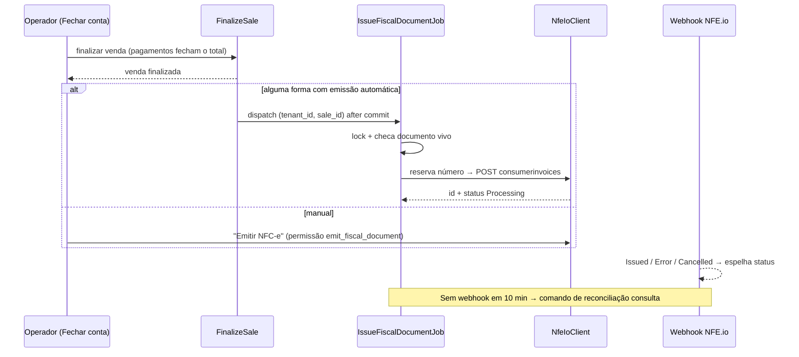

# Prioridade 1 — NFC-e via NFE.io no RazelFood

> Parte do plano [migracao-funcionalidades-pizzaria-app-para-razelfood.md](migracao-funcionalidades-pizzaria-app-para-razelfood.md).
> **Data:** 2026-11-04 · **Status:** planejamento, nada implementado.
> **Legenda:** **[FATO]** comprovado no código local do Pizzaria-App · **[INFERÊNCIA]** dedução a partir do código · **[HIPÓTESE]** confirmar com a NFE.io/contador · **[DECISÃO]** depende de aprovação.
> **Documentação oficial da NFE.io não foi consultada nesta etapa.** Endpoints, campos e status abaixo são os que o código do Pizzaria-App usa em produção. Qualquer campo novo precisa ser confirmado na documentação antes de entrar no payload.

---

## 1. Escopo da integração atual (Pizzaria-App)

| Item | Situação |
|---|---|
| Documento emitido | **Somente NFC-e (modelo 65)**, endpoint `consumerinvoices` da API v2 [FATO] |
| NF-e modelo 55 / NFS-e | Não emitidas [FATO] |
| NF-e de **entrada** (compras) | Existe, mas **não usa NFE.io**: SEFAZ DistDFe direto com certificado A1 (`app/Services/Sefaz/*`, `nfephp-org/sped-nfe`) + importação de XML (`NfeImportService`) + DANFE local (`DanfeService`, `sped-da`). Fora deste plano (feature `nfe_entrada`). |
| Pacote `nfe/nfe` no `composer.json` | Instalado, **não usado** pelo fluxo atual — o cliente é `Http` facade em `NfeIoService` [FATO] |

### 1.1 Arquivos de referência

| Arquivo | Papel |
|---|---|
| `app/Services/NfeIoService.php` | Cliente HTTP único (emitir, consultar, sincronizar status, cancelar, PDF, preview) + montagem do payload |
| `app/Services/Nfe/NfNumeracaoService.php` | Numeração própria com lock |
| `app/Services/Nfe/CompradorNfceService.php` | Decide se o comprador vai identificado |
| `app/Services/Nfe/EmissaoNfeAutomaticaService.php` | Regra de emissão automática + lock anti-duplicidade |
| `app/Services/Nfe/ReenvioNfeService.php` | Reenvio manual e bloqueios |
| `app/Jobs/EmitirNfeAutomaticaJob.php` | Emissão após webhook Stone (`dispatchAfterResponse`, `tries = 1`) |
| `app/Http/Controllers/NfeWebhookController.php` + `app/Http/Middleware/VerifyNfeIoSignature.php` | Webhook `POST /api/webhook/nfe-status` |
| `app/Console/Commands/NfeSincronizarStatus.php` | Reconciliação (agendada a cada 10 min no `Kernel`) |
| `app/Console/Commands/NfeNumeracaoDefinir.php` | Ajuste manual do último número |
| `app/Models/{NfEmissao,NfNumeracao,NfeWebhook,Empresa,Venda}.php` | Persistência |
| `app/Services/CancelamentoVendaService.php` | `solicitarCancelamentoNfe()` |
| `app/Filament/Pages/OperarVenda.php` (`iniciarEmissaoNfe`, `verificarStatusNfe`) | Modal de emissão com polling |
| `app/Http/Controllers/NfeVendaController.php`, `NotaFiscalController.php` | Rotas legadas (emitir, preview JSON, PDF, eventos, listagem) |
| `app/Services/RelatorioFiscalNotasService.php` | Relatório fiscal |

---

## 2. Configuração e autenticação [FATO]

| Dado | Onde | Observação |
|---|---|---|
| `empresa_api_nfeio_company_id` | `empresas` | ID da empresa na NFE.io |
| `empresa_api_nfeio_apikey` | `empresas` | **Texto puro** (sem cast `encrypted`) |
| `empresa_api_nfeio_conta_id` | `empresas` | Gravado pelo `EmpresaController`, não usado nas chamadas |
| `empresa_api_nfeio_ambiente` | `empresas` | `test`/produção; usado na **chave da numeração** e no filtro da listagem legada (`?environment=`) — **não é enviado** no POST de emissão [FATO] → [INFERÊNCIA] o ambiente é definido pela própria empresa/chave na NFE.io |
| `empresa_cnpj` | `empresas` | Chave da sequência de numeração |
| `empresa_percentual_imposto_nfe` | `empresas` (editado em `ConfiguracaoSefaz`) | Copiado para `vendas.venda_imposto_nfe_percentual` quando a nota é autorizada (relatório de carga tributária) |
| `NFE_IO_SECRET` | `.env` → `services.nfeio.webhook_secret` | Segredo HMAC do webhook, **global** |
| Certificado A1 (`empresa_certificado_*`) | `empresas` | Usado **só** pela consulta SEFAZ de entrada. Não é enviado à NFE.io [FATO] → [INFERÊNCIA] o certificado e o CSC da NFC-e ficam cadastrados no painel da NFE.io |

Autenticação: header `Authorization: {apiKey}` **sem** prefixo `Bearer`, `accept: application/json` [FATO, comentário em `NfeIoService::client()` diz ser a única variante comprovada em produção].

Verificação de configuração: `Empresa::nfeIoConfigurado()` = `company_id` e `apikey` preenchidos.

---

## 3. Endpoints usados [FATO — observados no código]

Base: `https://api.nfse.io/v2`

| Operação | Método e caminho | Resposta usada |
|---|---|---|
| Emitir | `POST /companies/{companyId}/consumerinvoices` | `id`, `status` (fila — resultado final é assíncrono) |
| Consultar | `GET /companies/{companyId}/consumerinvoices/{id}` | `status`, `number`, `lastEvents.events` |
| Cancelar | `DELETE /companies/{companyId}/consumerinvoices/{id}` | só sucesso/falha HTTP (resultado final por webhook) |
| DANFE | `GET /companies/{companyId}/consumerinvoices/{id}/pdf` | JSON `{ "uri": "..." }` |
| Listar | `GET /companies/{companyId}/consumerinvoices?environment=…&q=status:"Issued"&limit=50` | Tela legada `NotaFiscalController::index` |

Não usados (não existem no código): download de XML, inutilização, carta de correção, contingência [FATO]. Verificar na documentação se existem antes de planejar uso [HIPÓTESE].

---

## 4. Payload de emissão (estrutura observada)

```text
id                (string) venda.id
serie, number     reservados por NfNumeracaoService
operationOn       venda_datahora_finalizada
operationNature   "Venda de mercadoria"      ← fixo
operationType     "Outgoing"                 ← fixo
destination       "Internal_Operation"       ← fixo
purposeType       "Normal"                   ← fixo
consumerType      "FinalConsumer"            ← fixo
presenceType      "Presence"                 ← fixo (mesmo para delivery — ver R-NF-04)
buyer             CompradorNfceService::montar() ou null
payment[0]
  paymentDetail[] { method (opcaopag_desc_nfe), amount,
                    card { federalTaxNumber (CNPJ credenciadora), flag (bandeira),
                           authorization, integrationPaymentType } }   ← só se nome contém "Cartão"/"Pix"
                  + { method: "withoutPayment", amount: saldo fiado } se pago < total
  payback         soma dos trocos
items[]
  code, codeGTIN, description (≤120: categoria + sabores/descrição + respostas + "Adic. X")
  ncm, cfop, unit, quantity, unitAmount, totalAmount (bruto)
  unitTax, quantityTax, taxUnitAmount
  discountAmount, othersAmount (adicionais + ajuste + frete rateado + taxa de serviço rateada)
  totalIndicator, cest
  tax: CSOSN 102/500 → icms {origin, csosn, baseTax 0, amount 0, rate 0}
       demais       → totalTax + icms {origin, baseTaxModality '3', baseTax, amount, rate, csosn}
```

Códigos de forma de pagamento vistos no código: `creditCard`, `debitCard`, `InstantPayment`, `withoutPayment` (+ o que estiver em `opcaopag_desc_nfe`, cadastrado por forma) [FATO]. A lista completa aceita pela API não foi verificada [HIPÓTESE].

Status vistos no código: `Processing`, `Created`, `Issued`, `Cancelled`, `Error`, `IssueFailed`, `Failed`, `CancelFailed` + locais `Reservado`, `FalhaEnvio`, `CancelamentoSolicitado` [FATO]. Lista oficial completa não verificada [HIPÓTESE].

---

## 5. Regras de negócio fiscais

| ID | Regra | Onde | Motivo | RazelFood |
|---|---|---|---|---|
| RN-FIS-01 | Numeração **própria** por `(CNPJ emitente, ambiente, modelo 65, série)`; `lockForUpdate` na linha da sequência; `insertOrIgnore` para criar a sequência; unique `(numeracao_id, numero)` como 2ª barreira | `NfNumeracaoService` | Antes era `venda.id` → lacunas fiscais | Igual, com `tenant_id` na tabela mas **unique por CNPJ** (MT-05) |
| RN-FIS-02 | Reserva **antes** do POST; fica gravada mesmo se a NFE.io recusar; reenvio da mesma venda **reaproveita** o número enquanto não consumido (`Issued`, `Cancelled`, `CancelamentoSolicitado` = consumido) | `reservarPara()` | Não queimar número | Igual |
| RN-FIS-03 | Venda já autorizada não reserva outro número (exceção) | `reservarPara()` | Nota dupla | Igual |
| RN-FIS-04 | Ajuste do "último número" não pode retroceder abaixo do maior reservado | `definirUltimoNumero()` | Continuar sequência vinda de outro sistema sem duplicar | Ação na central/tenant com permissão alta |
| RN-FIS-05 | Números reservados há > 24 h e não consumidos = candidatos à **inutilização** (não executada) | `NfEmissao::scopePendentesInutilizacao` | Obrigação fiscal | Listar na v1; inutilizar depois de confirmar o endpoint [HIPÓTESE] |
| RN-FIS-06 | Venda só de cortesia não gera nota; item cortesia fica fora dos itens e dos rateios | `temItemFiscal()`, `montarItens()` | Cortesia não é venda | Igual quando cortesia existir |
| RN-FIS-07 | Frete rateado **igualmente** por item e taxa de serviço rateada **proporcionalmente ao valor**, em centavos (`RateioCentavos`), em `othersAmount` | `montarItens()` | 4,00/3 = 3,99 → nota rejeitada | Igual |
| RN-FIS-08 | `totalAmount = qtd × unitário` (vProd); diferença para o valor cobrado (fração de pizza, adicionais) vira desconto ou outras despesas por item | `valoresDoItem()` | SEFAZ calcula vProd; total precisa bater com pagamentos | Igual — crítico para sabores do RazelFood (rateio por média) |
| RN-FIS-09 | Pizza de sabores = **1 item**: "CATEGORIA 1/2 SABOR A / 1/2 SABOR B" (ASCII), NCM/CFOP/tributos do 1º sabor; descrição ≤ 120 | `montarItens()` | Fiscalmente é um produto | Igual, usando `order_items.flavors` |
| RN-FIS-10 | Comprador identificado **só** com nome + CPF/CNPJ válido (tenta o documento do tipo, depois o outro); senão nota sem comprador e o motivo é gravado (`comprador_motivo_omissao`) e mostrado ao operador | `CompradorNfceService` | Não recusar nota por cadastro incompleto | Igual; RazelFood já valida CPF (`ValidCpf`) e tem `require_client_cpf` |
| RN-FIS-11 | Saldo fiado declarado como `withoutPayment` | `montarPagamentos()` | Total de pagamentos = total da nota | Só quando houver fiado |
| RN-FIS-12 | **Emissão automática** quando algum pagamento usa forma com `opcaopag_envio_automatico_nfe`; não exige permissão do operador (regra de negócio) | `EmissaoNfeAutomaticaService::motivoNaoEmitir` | Cada estabelecimento decide (ex.: dinheiro sem nota) | Flag por forma de pagamento **por tenant** |
| RN-FIS-13 | Emissão automática protegida por `Cache::lock("nfe-automatica:venda:{id}", 120)` + checagem de `venda_id_nfe` | `EmissaoNfeAutomaticaService::emitir` | Job pós-webhook e conciliação Stone concorrendo | Igual (lock em cache `database` funciona no HostGator) |
| RN-FIS-14 | HTTP fora de transação; status gravado depois | `emitir()` | Transação longa / rollback de nota emitida | Igual |
| RN-FIS-15 | Status final por **webhook** (payload sempre persistido; assinatura inválida → 403 depois de gravar) ou **polling** do modal (PDV) ou **comando** a cada 10 min (vendas dos últimos 7 dias, finalizadas há > 10 min, limite 100, `usleep(150ms)`) | Webhook, `OperarVenda::verificarStatusNfe`, `NfeSincronizarStatus` | Webhook perdido | Igual, tenant a tenant |
| RN-FIS-16 | Bloqueios de reenvio: venda não finalizada; NFE.io não configurada; sem item fiscal; status em andamento (`Issued`, `Processing`, `Created`, `CancelamentoSolicitado`, `CancelFailed`) | `ReenvioNfeService::motivoBloqueio` | Nota duplicada | Igual |
| RN-FIS-17 | Cancelamento só de nota `Issued`; marca `CancelamentoSolicitado`; confirmação chega pelo webhook; recusa da SEFAZ (prazo) volta como exceção | `CancelamentoVendaService::solicitarCancelamentoNfe` | Prazo legal de cancelamento | Igual; exibir prazo restante [HIPÓTESE: prazo da UF] |
| RN-FIS-18 | Estorno total Stone cancela venda e solicita cancelamento da NFC-e; estorno **parcial** com nota emitida só gera log de erro "avaliar cancelamento manual" | `StoneRecebimentoService::processarChargeRefunded` | Não há nota parcial | Igual + alerta visível no painel (não só log) |
| RN-FIS-19 | % de imposto aproximado do emitente copiado para a venda na autorização | `Venda::booted` | Relatório de carga | Igual |
| RN-FIS-20 | Venda cancelada com nota viva é bloqueada no cancelamento em lote | `CancelamentoVendaService::motivoBloqueioCancelamento` | Consistência fiscal | Igual |

### 5.1 Regras que antecedem a emissão (pré-requisitos)

- Tenant: CNPJ, IE, regime (Simples Nacional na v1), endereço com código IBGE, `companyId`, `apiKey`, ambiente, série. [FATO: Pizzaria-App tem `empresa_endereco_cidade_id_ibge`]
- Produto: NCM, CFOP, CSOSN, origem, unidade comercial; opcionais CEST, GTIN, alíquotas ICMS/PIS/COFINS. [FATO: campos em `produtos`]
- Forma de pagamento: código fiscal (`desc_nfe`), flag de emissão automática; para cartão: bandeira e CNPJ da credenciadora (`cartoes_pagamentos`) e nº de autorização quando a forma exige. [FATO]
- Venda finalizada com pagamentos fechando o total (troco considerado). [FATO]

---

## 6. Situação no RazelFood

| Necessidade | Existe? | Observação |
|---|---|---|
| Venda/pagamento recebido | ❌ | `order_payments` = forma declarada no checkout (snapshot de nome, `is_cash`, valor, troco) |
| CNPJ e endereço do tenant | Parcial | `tenants.cnpj` e endereço **textual** (`city`, `state`); sem IE nem regime. O catálogo global `cities` já tem `ibge_code` (unique) — basta ligar o tenant a uma `city_id` |
| Campos fiscais de produto | ❌ | — |
| Código fiscal na forma de pagamento | ❌ | — |
| Cliente PJ / CNPJ / IE / e-mail | ❌ | Só CPF |
| Feature | Reservada | `FeatureKey::NFE_EMISSAO` (`is_available = false`) |
| Webhooks / API routes | ❌ | Não há `routes/api.php` de integração |
| Job tenant-aware | ❌ | Ver MT-01 |
| Cast `encrypted` para segredo | ❌ precedente ruim | `recaptcha_secret_key` em texto puro |

---

## 7. Desenho multi-tenant proposto

### 7.1 Modelo de contrato com a NFE.io [DECISÃO D-03]

| Opção | Como | Prós | Contras |
|---|---|---|---|
| A. Conta da Razel Tec, uma "company" por tenant | `apiKey` única (da Razel) + `companyId` por tenant | Onboarding controlado pela Razel; custo agregado; um segredo de webhook | Razel paga e repassa; chave única é ponto único de falha/vazamento |
| B. Conta própria de cada tenant | `apiKey` + `companyId` por tenant | Custo e responsabilidade com o lojista | Onboarding mais difícil; suporte depende do acesso do cliente |

**O modelo de dados suporta as duas**: `apiKey` fica por tenant, podendo repetir o mesmo valor (A) ou não (B). Confirmar com a NFE.io: se a API key é por conta ou por empresa, se o webhook é configurado por conta ou por empresa, e o modelo de cobrança [HIPÓTESE].

### 7.2 Tabelas (nomes em inglês, padrão do RazelFood)

| Tabela | Campos principais | Notas |
|---|---|---|
| `tenant_fiscal_settings` (1:1) | `tenant_id` (unique), `legal_name`, `cnpj`, `state_registration`, `tax_regime` (enum; v1 só `simples_nacional`), `city_ibge_code`, `provider` (`nfeio`), `nfeio_company_id`, `nfeio_api_key` (**encrypted**), `nfeio_webhook_secret` (**encrypted**), `environment` (`test`/`production`), `nfce_series`, `approximate_tax_percent`, `enabled_at` | Fora da tabela `tenants` para não entrar no cache `tenant:slug:*` |
| `fiscal_number_sequences` | `tenant_id`, `issuer_cnpj`, `environment`, `model` (65), `series`, `last_number` | **unique** `(issuer_cnpj, environment, model, series)` |
| `fiscal_documents` | `tenant_id`, `sale_id`, `sequence_id`, `model`, `series`, `number`, `status`, `provider_id` (id NFE.io), `decision` (`automatic`/`manual`), `user_id`, `sent_at`, `authorized_at`, `cancelled_at`, `error_message`, `buyer_omission_reason`, `access_key` [HIPÓTESE: campo na resposta], `pdf_url_cached_at`, `xml_path` [HIPÓTESE], soft deletes | unique `(sequence_id, number)`; index `(tenant_id, status)`; `provider_id` unique |
| `fiscal_webhooks` | `tenant_id` (nullable até resolver), `event`, `provider_id`, `fiscal_document_id`, `payload` (json), `signature_valid` (bool null), `processed_at` | Auditoria; append-only |
| `products` (+) | `ncm`, `cfop`, `csosn`, `cest`, `gtin`, `origin_code`, `commercial_unit`, `icms_rate`, `pis_rate`, `cofins_rate` | Ou tabela `product_fiscal_profiles` se o usuário preferir não inflar `products` [DECISÃO] |
| `categories` (+, opcional) | defaults fiscais herdados pelos produtos | Facilita onboarding (todas as pizzas com o mesmo NCM) |
| `payment_options` (+) | `fiscal_payment_code`, `auto_issue_fiscal_document`, `requires_card_brand`, `requires_authorization_code` | |
| `card_brands` (por tenant ou global) | `name`, `acquirer_cnpj` | No Pizzaria-App é `cartoes_pagamentos` |
| `clients` (+) | `person_type` (PF/PJ), `cnpj`, `state_registration`, `email` | |

### 7.3 Componentes

| Componente | Responsabilidade | Observações MT |
|---|---|---|
| `App\Services\Fiscal\NfeIoClient` | HTTP puro (emitir, consultar, cancelar, pdf) | Recebe `TenantFiscalSettings` **por parâmetro**; nunca lê contexto |
| `App\Actions\Fiscal\BuildNfcePayload` | Monta payload a partir de `Sale` (todas as RN-FIS-06..11) | Testável sem HTTP |
| `App\Actions\Fiscal\ReserveFiscalNumber` | RN-FIS-01..03 | Lock na sequência |
| `App\Actions\Fiscal\IssueFiscalDocument` | Reserva → POST → atualiza documento | HTTP fora de transação |
| `App\Actions\Fiscal\SyncFiscalDocumentStatus` | Consulta e espelha | |
| `App\Actions\Fiscal\CancelFiscalDocument` | RN-FIS-17 | |
| `App\Actions\Fiscal\ShouldAutoIssue` | RN-FIS-12 com motivo | Usa a feature do tenant |
| `App\Jobs\IssueFiscalDocumentJob` | Emissão automática | `RunsInTenantContext`; `tries` + backoff curto; lock RN-FIS-13 |
| `App\Http\Controllers\Webhooks\NfeIoWebhookController` | Grava `fiscal_webhooks`, valida HMAC **com o segredo do tenant do documento**, espelha status | Resolve documento por `provider_id` com `withoutGlobalScopes()`, então seta `CurrentTenant` |
| `App\Console\Commands\SyncFiscalDocumentsCommand` | RN-FIS-15 (reconciliação) | Itera tenants com feature ativa |
| `App\Support\Fiscal\FiscalReadiness` | Checklist de pré-requisitos (5.1) | Usado no painel e antes de emitir |
| Página `FiscalSettings` (tenant) + `FiscalDocumentResource` (tenant) | Configuração e acompanhamento | Gate pela feature `nfe_emissao` |
| Na central: coluna/relatório de uso por tenant | Custos (MT-11) | |

### 7.4 Webhook por tenant

Duas opções, recomendação **(2)**:

1. URL única `/webhooks/nfeio` → resolve documento por `id` do payload → descobre tenant → valida HMAC com o segredo **daquele** tenant. Problema: o payload precisa ser parseado antes de autenticar; se o `id` não existir, não há segredo para validar (gravar como não autenticado).
2. URL por tenant `/webhooks/nfeio/{webhookToken}` (token opaco por tenant, não o slug) → tenant resolvido antes → HMAC com o segredo dele → depois confere que o documento pertence ao tenant. Se a conta for única da Razel (opção A de 7.1) e o webhook for por conta, cai na (1) [HIPÓTESE].

Em ambos: gravar o payload **antes** de decidir 403 (comportamento atual do Pizzaria-App), `webhooks` no `reserved_slugs`, rota fora do grupo `{tenant}`, sem CSRF, com rate limit.

---

## 8. Fluxo operacional proposto



UX no fechamento de conta: modal "Emitindo NFC-e…" com polling (como `OperarVenda::verificarStatusNfe`), aviso de comprador omitido, botão "Imprimir DANFE" (abre a `uri` do PDF). Falha **não desfaz** a venda: documento fica `failed_to_send` e aparece na lista "pendências fiscais" com "Reenviar".

---

## 9. Riscos específicos

| # | Risco | Mitigação |
|---|---|---|
| R-NF-01 | Nota com tributação errada | `FiscalReadiness` bloqueia emissão; ambiente `test` obrigatório na ativação; primeira nota de homologação autorizada antes de liberar `production` |
| R-NF-02 | Regime diferente de Simples | v1 recusa configurar outro regime (mensagem clara) |
| R-NF-03 | XML não guardado localmente | Confirmar endpoint de XML na NFE.io; se existir, baixar após `Issued` para `storage/app/private/tenants/{id}/fiscal/{ano}/{chave}.xml` [HIPÓTESE] |
| R-NF-04 | `presenceType = Presence` fixo também para delivery | [HIPÓTESE] confirmar com contador/NFE.io o indicador correto para entrega; parametrizar por `fulfillment_type` |
| R-NF-05 | Detecção de cartão/PIX por nome da forma | Usar `fiscal_payment_code` |
| R-NF-06 | Números reservados e nunca usados | Lista de inutilização pendente por tenant; inutilização automática em fase posterior |
| R-NF-07 | Webhook de outro tenant alterando documento | Resolução pelo documento + verificação do tenant (7.4) + teste dedicado |
| R-NF-08 | `apiKey` vazando em log de erro | Nunca logar headers; `NfeIoException` sem request; teste que procura a chave no log |
| R-NF-09 | Fila parada no HostGator (cron de 1 min) | Emissão automática pode atrasar ~1 min — aceitável; modal manual continua síncrono |
| R-NF-10 | Custo por nota | Contador mensal por tenant na central |

---

## 10. Critérios de aceite (P1)

1. Tenant sem feature `nfe_emissao` não vê telas, botões nem rotas fiscais; job e comando o ignoram.
2. `FiscalReadiness` lista exatamente o que falta (tenant, produto, forma) e bloqueia emissão.
3. Dois caixas emitindo ao mesmo tempo nunca recebem o mesmo número (teste de concorrência por design + unique).
4. Reenvio após falha reaproveita o número; após cancelamento usa número novo.
5. Payload: testes com `Http::fake()` cobrindo pizza de 2 e 3 sabores, adicionais, frete rateado em 3 itens (R$ 4,00), taxa de serviço, comprador incompleto, comprador PJ, pagamento misto com troco — soma dos itens = soma dos pagamentos − troco, centavo a centavo.
6. Webhook: assinatura válida/inválida/ausente; payload sempre gravado; documento de outro tenant não é alterado.
7. Reconciliação muda status parado e loga só quando houve mudança.
8. Cancelamento de venda com nota autorizada solicita o cancelamento da nota; recusa vira mensagem para o operador.
9. Credenciais criptografadas no banco (teste lê a coluna crua e não encontra a chave), ausentes de logs e do cache de tenant.
10. Suíte completa verde; dados reais do dev intactos.

---

## 11. Perguntas para a NFE.io / contador (antes da Fase 1.2)

1. API key é por conta ou por empresa? Uma conta pode ter N empresas de CNPJs diferentes (modelo revenda)?
2. Webhook é por conta ou por empresa? Formato exato do header de assinatura (confirmar `X-Hub-Signature` + HMAC-SHA1 do corpo)?
3. Lista oficial de `status` da NFC-e e de `paymentDetail.method`.
4. Endpoints de XML, inutilização e contingência para NFC-e.
5. Onde ficam certificado A1 e CSC — confirmado que é no cadastro da empresa na NFE.io?
6. `presenceType` correto para delivery e retirada.
7. Cobrança por nota e limites de requisição.
